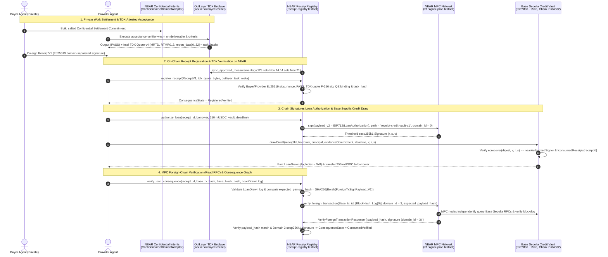

> **Post-Submission Hardening Branch (`hardening-post-submission`):** The original hackathon submission is preserved unmodified on [`main`](https://github.com/Johnlocke0347/Receipt/tree/main) and tag [`submitted-v1`](https://github.com/Johnlocke0347/Receipt/tree/submitted-v1) at commit `b55fedf1929d3ced523b9fa51f33119216834625`. This branch (`hardening-post-submission`) contains post-submission security hardening fixes, negative regression tests, live `wasm32-wasip1` FastFS OutLayer integration, and Apache-2.0 license alignment. See [`SECURITY-HARDENING.md`](./SECURITY-HARDENING.md) and [`docs/OUTLAYER_TODO.md`](./docs/OUTLAYER_TODO.md) for full details.

# RECEIPT — Cross-Chain Agent Credit Backed by Private, Attested Work

RECEIPT is a cross-chain reputation and credit primitive for autonomous agents. Every completed job produces a portable work credential that is co-signed by the buyer and provider, attested by an Intel TDX enclave, and turned into cross-chain collateral using NEAR Chain Signatures and MPC Foreign-Chain Verification (`Read RPC`).

**Live Testnet Loop:** A private work receipt is registered on NEAR → authorized for a credit loan via Chain Signatures → drawn on Base Sepolia → verified back on NEAR by the MPC network.

---

## Quick Demo & Verification (2 Minutes)

*   **Demo Video:** `(https://youtu.be/x2wtwXqngII)`
*   **Expected Outcome:** In a single verifiable loop, a TDX-attested `ReceiptV1` registered on `receipt-registry.testnet` unlocks a `250 mUSDC` credit draw on Base Sepolia (`0xf59f9d...95e8`) and is cryptographically verified back on NEAR by `v1.signer-prod.testnet` (`consequence_state = "ConsumedVerified"`, `is_mpc_consequence_verified = true`).

### Verify the Live On-Chain State in 4 Steps ("Do X → See Y")

1. **Query the Verified Consequence Proof on NEAR Testnet (`verify_consequence_proof`):**
   ```bash
   curl -s https://rpc.testnet.near.org -H "Content-Type: application/json" -d '{
     "jsonrpc": "2.0", "id": "1", "method": "query",
     "params": {
       "request_type": "call_function", "finality": "final",
       "account_id": "receipt-registry.testnet",
       "method_name": "verify_consequence_proof",
       "args_base64": "eyJyZWNlaXB0X2lkX2hleCI6IjQzYjQ2NDYwNzAzMzU1Y2VlYTEzNjQ2MTJhN2IzZWZlYTlhM2NjOTZjZjQwMmRkZjIyZWMxNjE1MjFhMjc2OGMifQ=="
     }
   }'
   ```
   **→ See:** JSON response showing `"consequence_state": "ConsumedVerified"`, `"is_mpc_consequence_verified": true`, `"foreign_chain_id": "eip155:84532"`, `"foreign_tx_hash": "f3ee1f5cfc78729821e7409dcecd31cfd29ae885dde5160435dd88ca9a708283"`, and the verified MPC Domain 3 threshold signature `(r, s, v)`.

2. **Verify the Derived MPC EVM Signer on NEAR (`derive_vault_authorized_signer_evm_address`):**
   ```bash
   curl -s https://rpc.testnet.near.org -H "Content-Type: application/json" -d '{
     "jsonrpc": "2.0", "id": "1", "method": "query",
     "params": {
       "request_type": "call_function", "finality": "final",
       "account_id": "receipt-registry.testnet",
       "method_name": "derive_vault_authorized_signer_evm_address",
       "args_base64": "e30="
     }
   }'
   ```
   **→ See:** `"0x6cb5858d8310045e4f2caea4e1231e4980af4e4b"`, matching the `nearAuthorizedSigner` immutable configured on the Base Sepolia `ReceiptCreditVault`.

3. **Inspect the Base Sepolia Credit Draw Receipt (`eth_getTransactionReceipt`):**
   ```bash
   curl -s https://sepolia.base.org -H "Content-Type: application/json" -d '{
     "jsonrpc": "2.0", "id": 1, "method": "eth_getTransactionReceipt",
     "params": ["0xf3ee1f5cfc78729821e7409dcecd31cfd29ae885dde5160435dd88ca9a708283"]
   }'
   ```
   **→ See:** `status: "0x1"`, `logs[0]` (`logIndex: "0x0"`) emitted by `0xf59f9d39f5fb76880bdc64fbcb7613e770d195e8` (`LoanDrawn` with `topics[1] = 0x43b46460703355ceea1364612a7b3efea9a3cc96cf402ddf22ec161521a2768c`), and `logs[1]` transferring `250,000,000` (`250 mUSDC`) from the vault to borrower `0xf4e355089852f302a69e6b6cf8b6d83dc09d9a42`.

4. **Run the Full Local Verification Suite (`cargo test` + `pytest`):**
   ```bash
   cargo test --workspace && uv run pytest -q
   ```
   **→ See:** All **76 Rust tests** (including real OutLayer TDX quote v4 DCAP verification, upstream NEAR MPC Borsh payload differential tests, post-submission negative security regression tests, and an in-memory `revm` cross-stack EVM integration test) and the Python test (`1` passed) pass.

### Key Live Contracts & Transactions at a Glance

| Surface | Identifier / Transaction Hash | Explorer Link |
| :--- | :--- | :--- |
| **NEAR Receipt Registry** | `receipt-registry.testnet` | [NearBlocks Testnet](https://testnet.nearblocks.io/address/receipt-registry.testnet) |
| **Base Sepolia Credit Vault** | `0xf59f9d39f5fb76880bdc64fbcb7613e770d195e8` | [BaseScan Sepolia](https://sepolia.basescan.org/address/0xf59f9d39f5fb76880bdc64fbcb7613e770d195e8) |
| **Base Sepolia MockCreditUSDC** | `0x99ac11cf7b392d27074253937163ad1a82786e8a` | [BaseScan Sepolia](https://sepolia.basescan.org/address/0x99ac11cf7b392d27074253937163ad1a82786e8a) |
| **Derived MPC EVM Signer** | `0x6cb5858d8310045e4f2caea4e1231e4980af4e4b` | Derived from `v1.signer-prod.testnet` (`domain_id: 0`, path `"receipt-credit-vault-v1"`) |
| **1. Sync OutLayer TDX Measurements** | `3Wm2R2Jb93ZiXQubfwACCjmFAqJiUWgZ5Wy88sBvSgxj` | [NearBlocks Tx](https://testnet.nearblocks.io/txns/3Wm2R2Jb93ZiXQubfwACCjmFAqJiUWgZ5Wy88sBvSgxj) (`129` approved worker measurements) |
| **2. Register Receipt (NEAR)** | `A5QEf2jnvB2nNCRVra249btAjt1h52TSV61AZ4bmQKBu` | [NearBlocks Tx](https://testnet.nearblocks.io/txns/A5QEf2jnvB2nNCRVra249btAjt1h52TSV61AZ4bmQKBu) (`receipt_id = 43b46460...2768c`) |
| **3. Authorize Loan (Chain Signatures)** | `FNsbX3M42GhWhQewi8kKFcNWi2xgASW9kPcYBTq6LeBL` | [NearBlocks Tx](https://testnet.nearblocks.io/txns/FNsbX3M42GhWhQewi8kKFcNWi2xgASW9kPcYBTq6LeBL) (`v1.signer-prod.testnet::sign`, `domain_id: 0`) |
| **4. Draw Credit (Base Sepolia)** | `0xf3ee1f5cfc78729821e7409dcecd31cfd29ae885dde5160435dd88ca9a708283` | [BaseScan Tx](https://sepolia.basescan.org/tx/0xf3ee1f5cfc78729821e7409dcecd31cfd29ae885dde5160435dd88ca9a708283) (`250 mUSDC` drawn) |
| **5. Verify Consequence (NEAR Read RPC)** | `3kgoyP8dr6nANZgzYmsrjp9PB3xPr29uD1oPTR25vJ6Y` | [NearBlocks Tx](https://testnet.nearblocks.io/txns/3kgoyP8dr6nANZgzYmsrjp9PB3xPr29uD1oPTR25vJ6Y) (`verify_foreign_transaction`, `domain_id: 3`) |

---

## Why This Matters (Problem → Solution)

*   **Problem:** Existing agent reputation standards (such as ERC-8004's Reputation Registry) store subjective feedback ("4/5 stars") on a single chain. Subjective ratings are trivially sybil-farmed, cannot be underwritten by deterministic DeFi credit vaults, and force commercial counterparties to expose private pricing and deliverables if they want verifiable history.
*   **Solution:** **RECEIPT** replaces subjective ratings with **cryptographic facts of completed, accepted work**:
    1. Commercial terms stay private behind a salted **Confidential Intents** settlement commitment.
    2. Acceptance evaluation runs deterministically inside an **OutLayer Intel TDX** enclave (tested live via a prebuilt `wasm32-wasip1` binary uploaded to FastFS via `WasmUrl`; see [`docs/OUTLAYER_TODO.md`](./docs/OUTLAYER_TODO.md) regarding GitHub-source builds and `wasm32-wasip2` worker instantiation limits) whose hardware quote (`MRTD` + `RTMR0..3` + `report_data[0..32] == task_hash`) is verified on NEAR against `worker.outlayer.testnet` and co-signed by both Buyer and Provider.
    3. The verified NEAR receipt directly authorizes an EIP-712 working-capital loan on **Base Sepolia** via **NEAR Chain Signatures** (`domain_id: 0`) and closes the accounting loop back on NEAR via **MPC Foreign-Chain Transaction Verification (`Read RPC`, `domain_id: 3`)**—without trusted relayers or bridges.

---

## Architecture Overview



---

## Live Testnet Deployments & Execution Evidence

### 1. `submitted-v1` Hackathon Baseline (`receipt-registry.testnet`)
*   **NEAR Registry:** `receipt-registry.testnet`
*   **Base Sepolia Vault:** `0xf59f9d39f5fb76880bdc64fbcb7613e770d195e8`
*   **Base Sepolia MockUSDC:** `0x99ac11cf7b392d27074253937163ad1a82786e8a`
*   **Derived MPC EVM Signer:** `0x6cb5858d8310045e4f2caea4e1231e4980af4e4b` (`secp256k1:4BUaArkKFhhnaUmFaxQ3ZDFJKScvpShfeQSo2rsDgLMj3SvfFCuVvZgtDbsntZYmgShfPynEJhYm6GiuEShHvzMS`)

1.  **Deploy NEAR Registry (`near_receipt_registry.wasm`):** `DEfUmG5F9gsuaYhX7A8Kz9WfZiFjH4CEKJPhYcXQqUv1` (Initialized in `E8PzpxoTcz6xFDshYocegkVCDXpNd4yGzeUfFpfTVkkV`)
2.  **Sync OutLayer TDX Measurements:** `3Wm2R2Jb93ZiXQubfwACCjmFAqJiUWgZ5Wy88sBvSgxj` (129 measurements synced from `worker.outlayer.testnet` on Nov 14)
3.  **Deploy & Fund Base Sepolia Contracts:**
    *   Deploy `MockCreditUSDC`: `0xead18ea5db9bc9ed1092ea69a47971259de1f16a806318a5aa49456a40a191d7`
    *   Deploy `ReceiptCreditVault`: `0x26cdc897ca4fbd06af1ddddf23f2c1b416b7ff6af7f8a7e06e2e593943486ad0`
    *   Fund Vault (`500,000 mUSDC`): `0xe70d318ebfc8b9cbd1eee78f0b02ec0356e820511facea6069b97bc5e3b6c919`
    *   Pin Vault on NEAR: `DWnTUSxw7TV76ZUWMnbTGy8irtRJ4vbhReoPvoetRsSd`
4.  **Register Receipt (NEAR):** `A5QEf2jnvB2nNCRVra249btAjt1h52TSV61AZ4bmQKBu` (`receipt_id = 43b46460703355ceea1364612a7b3efea9a3cc96cf402ddf22ec161521a2768c`, WASM hash pinned in `AiyrJfw5eNE7dqRDCgLeUvLNNXukWhCDJoxzGKqWD66z`)
5.  **Authorize Loan (NEAR Chain Signatures):** `FNsbX3M42GhWhQewi8kKFcNWi2xgASW9kPcYBTq6LeBL`
    *   `eip712_digest`: `c6e70dcce037da2dc4b527dd026b01abad9f8076f86d3b2990c8908eda57f23f`
    *   `r`: `3ef0e810a0eabaa2ca0adfaac46c3b334283cd06a83def3fe0234a6076a79b5a`
    *   `s`: `15409b4471b2de3cea80eb610e1b49385549b2c9da1aca695c02ce4c760cb8a3`
    *   `v`: `27`
6.  **Draw Credit (Base Sepolia):** `0xf3ee1f5cfc78729821e7409dcecd31cfd29ae885dde5160435dd88ca9a708283` (Block `0xb8ecab257cf946f17102f6df5c834177169061c4065f5e7de74c59321020365e`, `logIndex = 0x0`)
7.  **Verify Consequence (NEAR Read RPC):** `3kgoyP8dr6nANZgzYmsrjp9PB3xPr29uD1oPTR25vJ6Y` (`payload_hash = 54ea4b9c877c06831537bbf9b7d6c9be871d7ea15a45c09ce218f28bfeea4143`)

**MPC Domain 3 Signature (`submitted-v1` Proof of Verification):**
*   `r`: `0106b0af1622112404cb36ee9a20eaff48d863b62323d67750b0dbcf2a867001`
*   `s`: `238f95e757bd6455d5306605b537680227ca099d06b50e745b6f4e2cf802f28a`
*   `v`: `27`

### 2. `hardening-post-submission` Live Loop (`receipt-v2-test-20261121.testnet`, FastFS `wasm32-wasip1` Self-Verifier)
Executed from a clean clone of `hardening-post-submission` (checkpointed in [`artifacts/phase3_v2_checkpoint.json`](./artifacts/phase3_v2_checkpoint.json)). **Important:** OutLayer executed a locally compiled `acceptance-verifier-wasm` `wasm32-wasip1` binary (`115,266` bytes, SHA-256 `9465bd664f1cfa7ce54731ba4b5c411b4444ebde9064351b5e2b1761cc467dd1`) uploaded to FastFS (`WasmUrl`, tx `5Ai5kp28FxB3jDZCqR1twmmi9ciToibAvhVsNsmbXTyA`), **not** via OutLayer GitHub-source compilation (disabled on testnet).

*   **NEAR Hardened Registry:** `receipt-v2-test-20261121.testnet` (Deploy `7UaTFhDkJuv1jtpjb16CeHdRmpJ1nYKVxp2PhopdzSBH`, Init `BxM5cFKsuvwTbZ4v1ZtQpk7t6kt8KkfSRky9a5CxG1Ev`, Sync `4` live measurements `AraGWhi75SmRddy4V3ZjnDgmLYxAMkyJc1xyYY76JhCv`)
*   **Derived MPC EVM Signer:** `0xd67bb565e3c9a79914a815b32a167d81607293d8`
*   **Base Sepolia MockUSDC / Vault:** `0x3c9b91c75f925fee4a136853151cfd169140d7b6` (`0xba9f55502ad3dcbe3e99ca15348dc5a0c235364c10c23388e26be5a713f57c0a`) / `0xfbef17bd16fcfafddc5836db9f70850068d881f4` (`0x7f2249081ea85387165220c6e0414c047e365c5f3ebc8a5f2f7b9036d3884e8c`, funded `500,000 mUSDC` in `0xd03a91fe40e0c5a033f6f4307b5c1e1367017598e343ce593774b51dabd3b83d`, pinned in `BFUQ9Ap5Gfz4CUkJ2kDzQmT2sWh9nbqPeQ6zd6xLxkor`)
*   **Live Self-Verifier OutLayer Run (`wasm32-wasip1`, FastFS `WasmUrl`):** `8xgZC4xEAVS29PGw8H5Qui5PA1Jgp8FM9263dHBpPuFp` (`request_id = 106440`, `task_id = 303286`)
*   **Register Hardened Receipt (`enclave_output_hash` + `consumed_task_ids` + bound borrower/limit):** `CJsK1Yri7zfZtrZ3orN74yNgcANsEUj9ifHLUeEiXFK4` (pin hash `gvFYsCBsUSGWqVyZkgQBuFXtnZdXF8ynPHVQnHvwLvq`, `receipt_id = 5b3658c95615a9605888b1626349645779172dcc11eb8a7fd810ac63f7c3ea5f`)
*   **Authorize Loan / Draw Credit (`250 mUSDC`) / Verify Consequence:** `3Bp7jC4iZrDnMAc8GFBXGFnzT9w1mawy7uETQpJR8TP2` → `0xd3f56438675ba7871e8eda9bd8aef9a0e7ab397b8bf15f48a324eaccd741eb0b` → `7hDyG5sVPdYBPdmwWF7v5CQg9MLXAX7txS14qupGQQZe` (`ConsumedVerified`, `is_mpc_consequence_verified = true`, `is_task_id_consumed = true`)

---

## Architecture & Honesty Statement

*   **The Problem:** ERC-8004's Reputation Registry stores subjective feedback. It is chain-specific and easily manipulated. RECEIPT provides cryptographic proof of completed work.
*   **Confidential Intents Bridge:** NEAR's Confidential Intents private shard is mainnet-only and does not execute arbitrary contracts. To demonstrate the loop on testnet, we use a clearly labeled `TestnetConfidentialSettlementBridge` (`crates/receipt-core/src/confidential.rs`) alongside `OneClickIntentBuilder` to generate the salted commitment (`SHA256("RECEIPT_CONFIDENTIAL_V1" || intent_id || amount_le16 || currency_hash || buyer_salt)`) for the TDX acceptance test.
*   **TEE Capabilities:** Intel TDX proves code, input, and output integrity inside an approved enclave (verified against live `worker.outlayer.testnet` allowlist snapshots—129 measurement sets on Nov 14 and 4 active sets on Nov 21—plus full off-chain Intel DCAP PCK/CRL/TCB/QE verification via `dcap-qvl` in `crates/receipt-core/src/tdx.rs`). It does not judge subjective fairness; the buyer and provider co-sign the acceptance criteria.
*   **Live Testnet Evidence:** The TDX attestation, Chain Signatures loan authorization, and MPC verification are all live and verifiable on testnet.
- **What the live runs attest:** In `submitted-v1` (`receipt-registry.testnet`), the live receipt used an existing genuine OutLayer TDX quote (`task_id = 3000`, WASM hash `0eeb1b87…`) pinned as the expected WASM hash. On `hardening-post-submission` (`receipt-v2-test-20261121.testnet`), our own `acceptance-verifier-wasm` binary ran live on `worker.outlayer.testnet` (`request_id = 106440`, `task_id = 303286`) via a prebuilt `wasm32-wasip1` FastFS upload (`WasmUrl`)—not GitHub-source compilation—and its real TDX quote completed registration, Chain Signatures draw, and MPC Read RPC consequence verification.

---

## Post-submission progress

The original hackathon submission is preserved unmodified on `main` / annotated tag [`submitted-v1`](https://github.com/Johnlocke0347/Receipt/tree/submitted-v1) (`b55fedf1929d3ced523b9fa51f33119216834625`, tag object `ad24d4f25e1be994d8b73d3152639308d8a795de`). Work on `hardening-post-submission` adds the following security hardening and roadmap milestones (see [`SECURITY-HARDENING.md`](./SECURITY-HARDENING.md) for commit hashes and failing/passing regression proofs):

### What Was Hardened
1. **Borrower and credit limit bound into the co-signed receipt (`210fd36`):** Added `borrower_evm_address: [u8; 20]` and `max_credit_principal: u128` to `ReceiptSigningPayloadV1` and `ReceiptV1`, validated non-zero bounds on registration, and enforced exact borrower match and `principal_amount <= receipt.max_credit_principal` inside `ReceiptRegistry::authorize_loan`.
2. **`authorize_loan` restricted to the provider (`54d0a37`):** Enforced `rt::predecessor_account_id().as_str() == receipt.provider_identity` so third-party accounts cannot lock or front-run a verified receipt's loan authorization.
3. **OutLayer TDX quote task ID consumption (`04322dd`):** Added `consumed_task_ids: BTreeSet<u64>` (and `is_task_id_consumed(task_id)`) in `ReceiptRegistry::register_receipt` so a single OutLayer TDX quote (`task_id`) cannot be replayed across multiple receipts with incrementing nonces.
4. **Work outcome committed into the enclave output hash (`e3e6535`):** Introduced `enclave_output_hash(outcome, raw_enclave_output_hash) = SHA256("RECEIPT_OUTCOME_OUTPUT_V1" || [outcome as u8] || raw_enclave_output_hash)` and enforced it during `register_receipt` while preserving the raw `outlayer_task_meta.output_hash` check against TDX `report_data[0..32]`.
5. **Apache-2.0 `LICENSE` added (`c8d3e9a`, `4df2e5b`):** Added a root Apache-2.0 [`LICENSE`](./LICENSE) and aligned `Cargo.toml`, `pyproject.toml`, and Solidity SPDX headers (`MockCreditUSDC.sol`, `ReceiptCreditVault.sol`).
6. **Live self-verifier execution via OutLayer FastFS (`3eeb83e`, `8a53c89`):** Compiled `acceptance-verifier-wasm` to `wasm32-wasip1`, uploaded it to FastFS (`WasmUrl`), executed it inside a live `worker.outlayer.testnet` Intel TDX enclave (`request_id = 106440`, `task_id = 303286`), and verified the full hardened loop on `receipt-v2-test-20261121.testnet` and Base Sepolia (`0xfbef17bd16fcfafddc5836db9f70850068d881f4`).

### Planned Next Steps
- **Repayment and default handling on the Base vault:** Extend `ReceiptCreditVault.sol` beyond disbursement-only credit draws to track principal + accrued interest repayment, maturity deadlines, default slashing/liquidation triggers, and MPC Read RPC repayment attestations back to NEAR.
- **Agent Market financing SDK:** Package receipt co-signing, OutLayer TDX attestation requests, Chain Signatures loan authorization, and EVM credit draw/repayment into a drop-in TypeScript/Python SDK for autonomous agent marketplaces.
- **Lender dashboard:** Build an operator and liquidity-provider interface displaying live NEAR receipt consequence graphs (`RegisteredVerified` → `LoanAuthorized` → `ConsumedVerified`), TDX measurement allowlists, active Base vault utilization, and per-provider credit history.

---

## Known Gaps (Testnet Scope)

### Closed on `hardening-post-submission` (Present in `submitted-v1`)
- **Outcome binding & quote replay:** Fixed via `enclave_output_hash` (`RECEIPT_OUTCOME_OUTPUT_V1`) and `consumed_task_ids` tracking in `ReceiptRegistry::register_receipt` ([`SECURITY-HARDENING.md`](./SECURITY-HARDENING.md)).
- **`authorize_loan` permissionless caller & unbound terms:** Fixed by binding `borrower_evm_address` and `max_credit_principal` into the co-signed receipt and restricting `authorize_loan` to `receipt.provider_identity` ([`SECURITY-HARDENING.md`](./SECURITY-HARDENING.md)).

### Still Open on `hardening-post-submission`
- **Collusion / sybil pairs:** A buyer and provider controlled by one party can co-sign a fake job. Next: staking, per-pair credit caps, distinct-counterparty limits.
- **Credit, not yet a loan:** The vault disburses only. Repayment, interest, collateral, and liquidation are not built.
- **Self-reported acceptance metrics:** The enclave applies the rules faithfully to the supplied inputs; it cannot verify the external real-world truth of those inputs.
- **OutLayer deployment limits:** The live self-verifier run required a prebuilt `wasm32-wasip1` FastFS `WasmUrl` upload; OutLayer on-chain GitHub compilation is disabled on testnet, `wasm32-wasip2` component instantiation fails on the OutLayer worker under `rustc 1.100.0`, and OutLayer custody HTTPS API payment keys (`owner:nonce:key`) are unconfigured ([`docs/OUTLAYER_TODO.md`](./docs/OUTLAYER_TODO.md)).
- **Demo keys:** Buyer/provider keys are fixed in `demo_e2e.py`.
- **Trust assumptions:** Intel TDX hardware/DCAP root of trust, OutLayer approved measurements (`worker.outlayer.testnet`), NEAR MPC threshold network, and the testnet contract owner key.

## Repository Structure & How to Reproduce

| Path | Description |
| :--- | :--- |
| [`crates/receipt-core`](./crates/receipt-core) | Core cryptographic primitives: `ReceiptV1`, domain-separated Ed25519 co-signing, Intel TDX Quote v4 parser + `dcap-qvl` full DCAP collateral verifier, EIP-712 `LoanAuthorization` & `LoanDrawn` verifier, additive MPC KDF, and Borsh `ForeignTxSignPayload::V1`. |
| [`crates/acceptance-verifier-wasm`](./crates/acceptance-verifier-wasm) | Deterministic acceptance verifier compiled to `wasm32-wasip1` (executed live via FastFS on `worker.outlayer.testnet` and under `wasmtime`) and `wasm32-wasip2` (verified locally under `wasmtime`; live OutLayer worker instantiation currently fails). |
| [`crates/near-receipt-registry`](./crates/near-receipt-registry) | NEAR smart contract (`near-sdk` v5) managing approved OutLayer measurements, receipt registration, Chain Signatures loan authorization (`domain_id: 0`), and MPC foreign-tx verification (`domain_id: 3`). Includes `revm` cross-stack EVM integration test. |
| [`contracts/base-sepolia`](./contracts/base-sepolia) | `ReceiptCreditVault.sol` (EIP-712 signature verification, replay protection, CEI `LoanDrawn` emission) and `MockCreditUSDC.sol`. |
| [`src/receipt_orchestrator`](./src/receipt_orchestrator) | Live testnet probe (`probe.py`) and resumable end-to-end orchestrator (`demo_e2e.py`). |
| [`docs/PLAN.md`](./docs/PLAN.md) & [`docs/PROGRESS.md`](./docs/PROGRESS.md) | Full architectural specification, protocol discoveries, and complete verification report. |

### Run All Unit & Cross-Stack Integration Tests (No Credentials Needed)

```bash
# Run all 76 Rust tests (unit + real OutLayer TDX DCAP + upstream MPC Borsh + post-submission negative tests + revm Base Sepolia vault)
cargo test --workspace

# Run WASI builds for the deterministic acceptance verifier
cargo build --release -p acceptance-verifier-wasm --target wasm32-wasip1
cargo build --release -p acceptance-verifier-wasm --target wasm32-wasip2

# Run Python lint, strict type-checking, and test suite
uv run ruff check src tests
uv run mypy src tests
uv run pytest -q
```

### Reproduce Live Testnet Probe & Orchestrator

Populate `.env` with `NEAR_PRIVATE_KEY`, `BASE_SEPOLIA_RPC_URL`, `BASE_SEPOLIA_PRIVATE_KEY` (and `NEAR_ACCOUNT_ID` for `probe.py`; optional `NEAR_REGISTRY_ACCOUNT_ID` for `demo_e2e.py`, which pays OutLayer fees on-chain via NEAR deposit and does not use `OUTLAYER_PAYMENT_KEY`), then run:

```bash
# 1. Probe live v1.signer-prod.testnet::sign (Domain 0) and verify_foreign_transaction (Domain 3)
uv run python -m receipt_orchestrator.probe

# 2. Run or resume the Phase 3 end-to-end deployment and verification loop
uv run python -m receipt_orchestrator.demo_e2e
```
