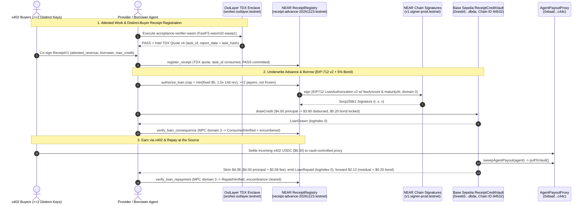

> **"Agents earn via x402 but can't borrow against future revenue. RECEIPT advances USDC against attested revenue and is repaid at the source, before the agent touches the money."**

# RECEIPT — Revenue-Backed Working Capital for Autonomous Agents

[](./LICENSE)
[](#how-to-reproduce)
[](#how-to-reproduce)
[-orange.svg)](#status)

**RECEIPT** turns cryptographically attested agent work (OutLayer Intel TDX acceptance verification + buyer/provider co-signatures on NEAR) into short-duration USDC advances on Base, with automatic repayment skimmed at the source from incoming x402 revenue before residual funds reach the agent.

---

## Status

* **Environment:** Testnet prototype only (**NEAR Testnet** + **Base Sepolia** with **`MockCreditUSDC`**).
* **Users:** Zero external design partners or third-party borrower/lender capital.
* **Security Audit:** **Unaudited.** Neither the Solidity vault/proxy nor the NEAR registry has been audited by an external security firm.
* **Mainnet:** **Not deployed.** `scripts/deploy_mainnet_dry_run.py` strictly requires `--dry-run`, queries only Base Sepolia RPC for read-only gas estimation, and refuses mainnet broadcasts or mainnet keys.

---

## Who Eats the Loss?

Every advance is capped at `min(fixed_cap, 1.5x trailing 14-day verified revenue)` — 1 to 2 weeks of attested earned revenue across at least two distinct buyers — with a hard per-agent ceiling of **$5.00** in the pilot configuration, so worst-case exposure per identity is strictly bounded and known before any USDC leaves the vault. If an agent stops routing incoming revenue through its vault-controlled `AgentPayoutProxy` and fails to repay within `maturityAt + gracePeriodSecs`, anyone can trigger permissionless `markDefaulted` liquidation: losses hit (1) the borrower's withheld **5% holdback bond** (`providerHoldbackBond`), (2) the **junior first-loss reserve** (`juniorFirstLossReserve`), and only if junior capital is exhausted (3) **senior liquidity LPs** (`seniorLiquidityReserve`), while permanently freezing the defaulting agent on both Base and NEAR.

---

## Submission Snapshot (`submission-2026-11-14`)

The original NEAR AI Hackathon submission (Nov 14, 2026) is preserved unmodified at annotated tag [`submission-2026-11-14`](https://github.com/Johnlocke0347/Receipt/tree/submission-2026-11-14) (legacy alias `submitted-v1`) and backup branch [`submission-snapshot`](https://github.com/Johnlocke0347/Receipt/tree/submission-snapshot) at commit `b55fedf1929d3ced523b9fa51f33119216834625`, with the original contracts (`receipt-registry.testnet`, Base Sepolia vault `0xf59f9d39f5fb76880bdc64fbcb7613e770d195e8`) left untouched so the demo video remains verifiable.

Following confirmation from the NEAR organizers that post-submission updates are permitted, two branches were merged to `main` via `--no-ff` merge commits:
1. **`hardening-post-submission`** ([`SECURITY-HARDENING.md`](./SECURITY-HARDENING.md)): Bound `borrower_evm_address` and `max_credit_principal` into the co-signed `ReceiptV1`, restricted `authorize_loan` to `receipt.provider_identity`, enforced single-use `consumed_task_ids` against TDX quote replay, committed `WorkOutcome` into `enclave_output_hash`, added Apache-2.0 [`LICENSE`](./LICENSE), and ran our own `acceptance-verifier-wasm` binary live inside `worker.outlayer.testnet` via a FastFS `wasm32-wasip1` upload (`hardening_v2`).
2. **`advance-flow`** (this version): Added the full x402 revenue-advance loop — `AgentPayoutProxy` per borrower, automatic `sweepAgentPayout` source repayment skim, 14-day `1.5x` trailing revenue advance cap, `min_distinct_payers` gate, config-driven ERC-20 token address, 3-tier first-loss waterfall + permissionless `markDefaulted`, NEAR MPC repayment/default callbacks, ERC-8004-compatible summary views/events, dry-run mainnet script with `$5` cap + pause switch, threat model, and live testnet borrow -> earn -> repay verification (`advance_flow_v3`).

---

## Audit Table (Implemented vs Verified by Running)

| feature | works (verified by running) | partial | missing |
| :--- | :--- | :--- | :--- |
| **Vault-controlled payout address per agent (`AgentPayoutProxy`)** | **Yes** — deployed & swept live on Base Sepolia ([`0xbaaf...c44c`](https://sepolia.basescan.org/address/0xbaaf339444fbf398c0523e6b45991fe902e8c44c)) and in `revm` cross-stack tests (`x402_revenue_advance_borrow_earn_auto_skim_repay_end_to_end`) | — | — |
| **Automatic repayment skim from incoming USDC (`sweepAgentPayout`)** | **Yes** — ran live (`0xab2d...1b91` skimmed `$4.08` of `$6.00` incoming, released `$0.20` bond, forwarded `$2.12`; verified back on NEAR as `RepaidVerified` in `CKwm...itVE`) & `revm` | — | — |
| **Advance cap = `min(fixed cap, 1.5x trailing 14-day verified revenue)`** | **Yes** — ran live on NEAR (`compute_advance_cap` / `get_trailing_14d_revenue` returned `4000000` -> cap `5000000`) & unit-tested with >14-day expiry (`advance_cap_excludes_receipts_older_than_14_days`) | — | — |
| **Config-driven token address (`MockUSDC` now, real `USDC` later)** | **Yes** — `ReceiptCreditVault` constructor `_creditToken`, [`config/deployments.json`](./config/deployments.json), `BASE_CREDIT_TOKEN_ADDRESS` env override, and `--token-address` CLI flag | — | — |
| **Distinct-independent-payer check** | **Yes** — live run registered 2 distinct buyer keys (`distinct_payers=2`); negative test (`distinct_independent_payers_required_rejects_single_buyer_wash_trade`) blocks single-buyer repeat farming | — | — |
| **First-loss pool accounting (holdback + junior + senior)** | **Yes** — live `depositFirstLoss` (`$50`) + `depositSeniorLiquidity` (`$200`) + 40% junior fee yield share on repayment verified live & in `revm` | — | — |
| **Repayment-history write-back in an ERC-8004-compatible form** | — | **Partial** — Base vault emits `Erc8004FeedbackPrepared` & exposes `getErc8004ReputationSummary` (live query returned `count=1, value=100, decimals=0`); NEAR exposes `get_erc8004_reputation_summary` | Cross-contract write call to an external live ERC-8004 Reputation Registry singleton |
| **Default handling (`markDefaulted` + `verify_loan_default` freeze)** | **Yes (unit + `revm` tests)** — `default_waterfall_slashes_bond_and_junior_pool_and_freezes_near_credit` slashes holdback bond + junior reserve, emits `LoanDefaulted` at `logIndex 0`, updates NEAR to `DefaultedVerified`, and freezes borrower; *happy path ran live on testnet, default path verified in `revm` + NEAR unit tests* | — | — |
| **Mainnet deploy script with `$5` hard cap and owner pause** | — | **Partial** — [`scripts/deploy_mainnet_dry_run.py`](./scripts/deploy_mainnet_dry_run.py) `--dry-run` verified against Base Sepolia RPC (`2,680,582` deploy gas estimate) and unit-tested for safety guards (`tests/test_advance_and_dry_run.py`) | Live mainnet deployment (disabled intentionally until external audit) |

---

## Architecture Overview



---

## Live Testnet Deployments & Comparison vs `main`

All deployment metadata is stored in [`config/deployments.json`](./config/deployments.json):

| Profile | Registry / Vault | Matches current `main`? | Live Verified Flows |
| :--- | :--- | :--- | :--- |
| **`advance_flow_v3`** *(current)* | [`receipt-advance-20261123.testnet`](https://testnet.nearblocks.io/address/receipt-advance-20261123.testnet) · Vault [`0xeeb5...dbda`](https://sepolia.basescan.org/address/0xeeb53bf1a753ecc9cfc82c00fa7f61f7df57dbda) · Proxy [`0xbaaf...c44c`](https://sepolia.basescan.org/address/0xbaaf339444fbf398c0523e6b45991fe902e8c44c) | **Yes — matches `main`** | Full `borrow -> earn -> sweep -> RepaidVerified` cycle with 2 OutLayer `wasm32-wasip1` runs & 2 distinct buyer receipts |
| **`hardening_v2`** *(preserved)* | [`receipt-v2-test-20261121.testnet`](https://testnet.nearblocks.io/address/receipt-v2-test-20261121.testnet) · Vault [`0xfbef...81f4`](https://sepolia.basescan.org/address/0xfbef17bd16fcfafddc5836db9f70850068d881f4) | No — pre-advance hardened contract | Post-submission hardened draw loop (`ConsumedVerified`) |
| **`submission_2026_11_14`** *(preserved)* | [`receipt-registry.testnet`](https://testnet.nearblocks.io/address/receipt-registry.testnet) · Vault [`0xf59f...95e8`](https://sepolia.basescan.org/address/0xf59f9d39f5fb76880bdc64fbcb7613e770d195e8) | No — Nov 14 hackathon baseline (untouched for demo video) | Original Nov 14 draw loop (`ConsumedVerified`) |

### `advance_flow_v3` Observed Live Transactions (`uv run python -m receipt_orchestrator.advance_cycle`)

* **NEAR Deployment / Policy / Sync:** [`9ozUnbaRMRdes6y7DSLhRGR7CrjneLRWgaXSQnKfNA8Z`](https://testnet.nearblocks.io/txns/9ozUnbaRMRdes6y7DSLhRGR7CrjneLRWgaXSQnKfNA8Z)
* **OutLayer Runs (`wasm32-wasip1` FastFS):** [`6x6BQse4Wo9wvxgKthcS5mDZ5LZiai3mHeASEcWcNnMo`](https://testnet.nearblocks.io/txns/6x6BQse4Wo9wvxgKthcS5mDZ5LZiai3mHeASEcWcNnMo) · [`ERQKT4WZY8A9TS7b1ygmNvEndmfvYfey2JhBLfeBvZRe`](https://testnet.nearblocks.io/txns/ERQKT4WZY8A9TS7b1ygmNvEndmfvYfey2JhBLfeBvZRe)
* **Distinct-Buyer Receipt Registrations:** [`FjDa9BkuochEqjjoJjUmoTnG8PxGPC9MbyxFtpECU1pa`](https://testnet.nearblocks.io/txns/FjDa9BkuochEqjjoJjUmoTnG8PxGPC9MbyxFtpECU1pa) · [`27RHoz6JwsVTvBfH3R7v98KRmNaFbrVxoEUy6PiS3QbS`](https://testnet.nearblocks.io/txns/27RHoz6JwsVTvBfH3R7v98KRmNaFbrVxoEUy6PiS3QbS)
* **BORROW (`authorize_loan` -> `drawCredit` -> `verify_loan_consequence`):** [`B4tRyX6Eync7kgjMEhybf273vRb6r5ZChJCy2nDzeHns`](https://testnet.nearblocks.io/txns/B4tRyX6Eync7kgjMEhybf273vRb6r5ZChJCy2nDzeHns) → [`0xaf8b...59ce`](https://sepolia.basescan.org/tx/0xaf8b3b2f3e834b1f44279a105a6ca3652fa4f6c469ce8b1a0f1088b165fe59ce) → [`DW5sGDw5TNpbvJRUonFWy1yA8FBvSzYsvAYhLwhSbeqh`](https://testnet.nearblocks.io/txns/DW5sGDw5TNpbvJRUonFWy1yA8FBvSzYsvAYhLwhSbeqh) (`ConsumedVerified`, `$4.00` drawn / `$3.80` net / `$0.20` bond)
* **EARN (`$6.00` x402 mcUSDC -> `AgentPayoutProxy`):** [`0xab5d...bbd3`](https://sepolia.basescan.org/tx/0xab5d9192535608538b0c5ebe3d4ba056212346109edfcc6aae95262c823cbbd3)
* **REPAY AT SOURCE (`sweepAgentPayout` -> `verify_loan_repayment`):** [`0xab2d...1b91`](https://sepolia.basescan.org/tx/0xab2de771c0942ec9521fbee26ce019c78da52dd64bb0137a2abab99486621b91) → [`CKwmHPYTvG7JtMvyaZp8B6ss4qWDe4SEQzzVAhAGitVE`](https://testnet.nearblocks.io/txns/CKwmHPYTvG7JtMvyaZp8B6ss4qWDe4SEQzzVAhAGitVE) (`RepaidVerified`, `$4.08` skimmed, `$2.12` forwarded to borrower, encumbrance cleared, ERC-8004 summary `count=1, value=100`)

---

## Roadmap

Every item not verified live on testnet or backed by external deployment is **planned**:

* **Live external ERC-8004 Reputation Registry write-back contract call** — **`planned`** *(currently emits `Erc8004FeedbackPrepared` and serves summary views internally)*
* **Live x402 facilitator middleware setting `payTo = AgentPayoutProxy`** — **`planned`** *(currently tested via direct ERC-20 transfer to the deployed `AgentPayoutProxy`)*
* **Independent smart-contract & cryptographic security audit** — **`planned`**
* **Live Base Mainnet + NEAR Mainnet deployment (real USDC, `$5` initial per-agent cap)** — **`planned`** *(dry-run script only today)*
* **External LP & lender monitoring dashboard** — **`planned`**

---

## Key Security & Threat Model Docs

* [`THREAT_MODEL.md`](./THREAT_MODEL.md): TDX side-channels/freshness/replay, NEAR MPC Domain 0 & Domain 3 trust assumptions, Sybil/wash-trade revenue limits, smart-contract invariants, hardening regressions, and breakeven default math.
* [`DESIGN_PARTNER.md`](./DESIGN_PARTNER.md): Exact ask for pilot partners, x402 `AgentPayoutProxy` integration flow, and one-command testnet reproduction.
* [`SECURITY-HARDENING.md`](./SECURITY-HARDENING.md): Detailed negative test proofs and commits for the 4 post-submission vulnerability fixes.
* [`docs/OUTLAYER_TODO.md`](./docs/OUTLAYER_TODO.md): Notes on FastFS `wasm32-wasip1` vs GitHub-source builds and `wasm32-wasip2` worker limits.

---

## How to Reproduce

### 1. Local Verification Suite (No Credentials Needed)

```bash
# 83 Rust tests: receipt-core (46), outlayer/MPC DCAP integration (7),
# acceptance-verifier-wasm (8), near-receipt-registry (19), revm cross-stack (3)
cargo test --workspace

# Contract WASM release build + Clippy + formatting
cargo fmt --all --check
cargo clippy --workspace --all-targets -- -D warnings
cargo clippy -p near-receipt-registry --target wasm32-unknown-unknown -- -D warnings
cargo build --release -p near-receipt-registry --target wasm32-unknown-unknown

# Python checks and dry-run safety tests
uv run ruff check src tests scripts
uv run mypy src tests scripts
uv run pytest -q
```

### 2. Live Testnet Borrow → Earn → Repay Cycle

Populate `.env` with `NEAR_PRIVATE_KEY`, `BASE_SEPOLIA_RPC_URL`, and `BASE_SEPOLIA_PRIVATE_KEY` (and optional `BASE_CREDIT_TOKEN_ADDRESS` or `NEAR_ADVANCE_REGISTRY_ACCOUNT_ID`), then run:

```bash
uv run python -m receipt_orchestrator.advance_cycle
```

### 3. Mainnet Deployment Planner (Dry-Run Only on Testnet)

```bash
uv run python scripts/deploy_mainnet_dry_run.py --dry-run
```
