# RECEIPT — Architectural Specification & 3-Phase Implementation Plan

> **Cross-Chain Agent Credit Backed by Private, Attested Work**  
> Built on **NEAR Confidential Intents**, **OutLayer Intel TDX**, and **NEAR Chain Signatures + MPC Foreign-Chain Transaction Verification (`Read RPC`)**.

---

## 1. Executive Thesis & Architectural Boundaries

Feedback and reputation registries record subjective opinions about an autonomous agent. **RECEIPT** records cryptographic facts:
1. **Private Settlement**: An agent completed work settled through NEAR Confidential Intents without exposing sensitive deal terms, pricing, or buyer identity on public ledgers.
2. **Hardware-Attested Acceptance**: A deterministic WebAssembly (`wasm32-wasip2`) acceptance verifier executed inside an approved **OutLayer Intel TDX** Confidential VM (`outlayer.testnet` / `worker.outlayer.testnet`), binding the exact `wasm_hash`, `input_hash`, `output_hash`, and job commitment into a hardware-signed Intel DCAP TDX quote v4 (`report_data[0..32]`).
3. **Co-Signed Canonical Receipt**: Both Buyer and Provider co-sign a domain-separated, replay-protected canonical receipt commitment (`RECEIPT_V1`), registered on the public NEAR `ReceiptRegistry` contract without leaking private terms or deliverables.
4. **Cross-Chain Economic Consequence (Base Sepolia)**: Upon validating the receipt's signatures, nonce, `PASS` outcome, and TDX quote measurements (`MRTD` + `RTMR0..3`) + `report_data` hash, the NEAR contract derives a deterministic EVM key via **NEAR Chain Signatures** (`v1.signer-prod.testnet`, `domain_id: 0`) and signs an EIP-712 / ECDSA loan authorization for a `ReceiptCreditVault` contract on **Base Sepolia** (`chainId: 84532`). The Provider never holds a Base private key for authorization, and no relayer can alter the signed loan parameters.
5. **MPC Foreign-Chain Transaction Verification (`Read RPC`)**: After the loan executes on Base Sepolia, the NEAR `ReceiptRegistry` does **not** trust a user-supplied transaction hash. Instead, it invokes `verify_foreign_transaction` on `v1.signer-prod.testnet` (`domain_id: 3`, `DomainPurpose::ForeignTx`) with `ForeignChainRpcRequest::Base(EvmRpcRequest { tx_id, extractors: [BlockHash, Log { log_index: 0 }], finality: EvmFinality::Finalized })` and an explicit `expected_payload_hash` (SHA-256 of Borsh-serialized `ForeignTxSignPayload::V1`). Only when the MPC threshold network independently queries Base RPCs, verifies finality and event log contents, and returns a valid threshold signature over `expected_payload_hash` does the NEAR registry transition the receipt to `ConsumedVerified` and append the verified economic consequence to the agent's cross-chain credit graph.

---

## 2. Technical Feasibility Audit Matrix (Live Probed 2026-11-13)

Before designing component boundaries, we audited live endpoints, deployed contract states, and upstream source code across all five required surfaces.

| Technology Surface | Official Documentation & Source | Live Contract / API Interfaces | Credentials Required | Testnet Availability & Live Probe Status | Known Limitations & Integration Risks | Architectural Adapter / Mitigation |
| :--- | :--- | :--- | :--- | :--- | :--- | :--- |
| **1. NEAR Confidential Intents** | [docs.near-intents.org](https://docs.near-intents.org), [out-layer/outlayer API.md](https://github.com/out-layer/outlayer/blob/main/API.md) | **1Click REST**: `POST https://1click.chaindefuser.com/v0/quote` (`depositType: "CONFIDENTIAL_INTENTS"` or `confidentiality: "advanced"`)<br>**OutLayer Custody Proxy**: `POST /wallet/v1/confidential/{shield,transfer,swap,withdraw}` | NEP-413 signed intent payload or OutLayer `Authorization: Bearer wk_...` | **Mainnet-only solver network.** As explicitly documented in OutLayer `API.md`: *"NEAR Intents is mainnet-only. Testnet does not run the Intents solver network."* Also, the Confidential Intents private shard does **not** run arbitrary user smart contracts. | 1. No custom registry contract inside the private shard.<br>2. Solver network does not settle on NEAR Testnet.<br>3. Deposit/shield and withdrawal/unshield edges are publicly visible on origin/destination chains; only intra-shard transfers/swaps hide amounts and counterparties. | Build an explicit **`ConfidentialSettlementAdapter`** (`packages/receipt-core/src/confidential_adapter.rs`):<br>• Supports live **1Click / Confidential Intents payload construction, NEP-413 intent signing, and dry-run/quote verification**.<br>• For Testnet E2E execution, includes a clearly labeled **`TestnetConfidentialSettlementBridge`** that produces the exact canonical `confidential_settlement_commitment = SHA256("RECEIPT_CONFIDENTIAL_V1" \|\| intent_hash \|\| blinding_factor)` while isolating private terms (`price`, `buyer_id`, `deliverable_uri`) in an encrypted off-chain envelope verified inside TDX. |
| **2. OutLayer Intel TDX** | [outlayer.ai](https://outlayer.ai), [github.com/out-layer/outlayer](https://github.com/out-layer/outlayer) (`WORKER_ATTESTATION.md`) | **NEAR Testnet Contract**: `outlayer.testnet` (`request_execution`)<br>**Worker Registry**: `worker.outlayer.testnet` (`get_approved_measurements`, `is_measurements_approved`)<br>**REST API**: `https://testnet-api.outlayer.ai` (`POST /call/{owner}/{project}`, `GET /attestations/by-request/{id}`, `GET /attestations/by-call/{id}`) | NEAR Testnet account with attached NEAR deposit (for `outlayer.testnet::request_execution`) or `X-Payment-Key` for HTTPS API. | **LIVE & VERIFIED on Testnet.**<br>• `outlayer.testnet` is live (code hash `AsbxRWTQ...`).<br>• `worker.outlayer.testnet` returned 26 approved 5-measurement sets (`mrtd`, `rtmr0..3`).<br>• `testnet-api.outlayer.ai/public/workers` shows `testnet-executor-c3a3dcc7...` online.<br>• Sampled `/attestations/by-request/1` returned a full 4KB+ Intel DCAP v4 TDX quote (`BAACAIEA...`). | 1. TDX proves *code + input + output integrity* inside an approved CVM (`MRTD` + `RTMR0..3`); it does **not** prove subjective fairness of acceptance criteria.<br>2. Full X.509 PCK certificate chain parsing (`dcap-qvl`) is heavy in gas if run on every receipt call. | 1. Buyer and Provider co-sign the `wasm_hash` and `criteria_hash` prior to execution.<br>2. Our verifier parses the raw binary Intel TDX v4 quote header + TD10 body (584 bytes), extracts `MRTD` (offset `184..232`) and `RTMR0..3` (offsets `376..568`), verifies `report_data[0..32]` against `SHA256(task_type \|\| task_id \|\| ... \|\| wasm_hash \|\| input_hash \|\| output_hash \|\| ...)`, checks measurements against `worker.outlayer.testnet` allowlist, and verifies the ECDSA P-256 quote signature off-chain + on-chain structural binding. |
| **3. NEAR Chain Signatures** | [docs.near.org/chain-abstraction/chain-signatures](https://docs.near.org/chain-abstraction/chain-signatures), [github.com/near/mpc](https://github.com/near/mpc) | **NEAR Testnet Contract**: `v1.signer-prod.testnet`<br>**Method**: `sign({ request: { payload_v2, path, domain_id: 0 } })`<br>**Keyset**: `domain_id: 0` (`CaitSith` Secp256k1, root PK `secp256k1:4NfTiv3U...`, threshold 11) | NEAR Testnet account + `15 TGas` minimum (`sign_call_gas_attachment_requirement_tera_gas`) + `1 yoctoNEAR` deposit. | **LIVE & VERIFIED on Testnet.**<br>• `v1.signer-prod.testnet` state is `Running` at `epoch_id: 27`.<br>• `domain_id: 0` and `domain_id: 4` are active Secp256k1 `Sign` domains. | `v1.signer-dev.testnet` currently panics on `state()` deserialization; we must strictly target **`v1.signer-prod.testnet`**. | Configure `v1.signer-prod.testnet` (`domain_id: 0`) as default in `ReceiptRegistry`. Derive deterministic EVM signer address for `(receipt_registry.testnet, derivation_path)`. Use Chain Signatures to sign an EIP-712 `LoanAuthorization` digest bound to `(receipt_id, borrower_evm, principal, nonce, deadline, chainId: 84532, vault_address)`. |
| **4. MPC Foreign-Chain Tx Verification (`Read RPC`)** | [github.com/near/mpc](https://github.com/near/mpc) (`crates/contract/src/api/foreign_chain/requests.rs`, `crates/near-mpc-sdk/src/foreign_chain/base.rs`) | **NEAR Testnet Contract**: `v1.signer-prod.testnet`<br>**Method**: `verify_foreign_transaction({ request: VerifyForeignTransactionRequestArgs })`<br>**Domains**: `domain_id: 3` or `7` (`DomainPurpose::ForeignTx`, `CaitSith` Secp256k1) | NEAR Testnet account + `>= 25 TGas` (15 TGas call + 7 TGas callback) + `1 yoctoNEAR` deposit. | **LIVE & VERIFIED on Testnet.**<br>• `get_available_foreign_chains()` on `v1.signer-prod.testnet` explicitly returns `["Solana","Base","Bnb","Arbitrum","Abstract","Starknet","Polygon","HyperEvm","Aptos","Sui","Avalanche","Fogo"]`.<br>• `domain_id: 3` (`secp256k1:2KGCoy2p...`) is active for `ForeignTx`. | 1. Base OP-Stack L1 `Finalized` status on Sepolia can take ~12-15 minutes if waiting for Ethereum L1 batch finality, whereas MPC nodes querying Base RPCs with `EvmFinality::Finalized` vs `Safe`/`Latest` depend on Base Sepolia RPC finality.<br>2. MPC node RPC provider keys on testnet may occasionally rate-limit or time out (`yield/resume` timeout ~150 blocks). | 1. Construct exact `VerifyForeignTransactionRequestArgs` with `ForeignChainRpcRequest::Base(EvmRpcRequest { tx_id, extractors: [BlockHash, Log { log_index: 0 }], finality })` and precompute `expected_payload_hash` via Borsh `ForeignTxSignPayload::V1`.<br>2. Support configurable finality (`Finalized` default, `Safe`/`Latest` configurable for fast demo mode with explicit labeling) and verify both `response.payload_hash == expected_payload_hash` and the MPC threshold ECDSA signature in the callback. |
| **5. Base Sepolia Lender Contract** | [docs.base.org](https://docs.base.org) | **RPC**: `https://sepolia.base.org` (`chainId: 0x14a34` / `84532`)<br>**Contracts**: `ReceiptCreditVault.sol` + `MockCreditUSDC.sol` | Funded Base Sepolia deployer/relayer key (for deploying `ReceiptCreditVault` and broadcasting the borrower's transaction). | **LIVE & VERIFIED.**<br>• `https://sepolia.base.org` responded with `0x14a34` (`84532`). | Local Windows machine does not have `forge` or `near` CLI pre-installed globally. | Use **Rust (`alloy` / `ethers` + `near-jsonrpc-client` / `near-crypto`)** and **Python (`uv run` with `py-solc-x` / `web3`)** or `npx solc` to compile Solidity contracts and execute all NEAR & Base Sepolia deployments, transactions, and tests cleanly on Windows PowerShell without external binary dependencies. |

---

## 3. End-to-End Architecture & Data Flow

```mermaid
sequenceDiagram
    autonumber
    actor Buyer as Buyer Agent (Private)
    actor Provider as Provider Agent
    participant CI as NEAR Confidential Intents<br/>(ConfidentialSettlementAdapter)
    participant TDX as OutLayer TDX Enclave<br/>(outlayer.testnet / worker.outlayer.testnet)
    participant Registry as NEAR ReceiptRegistry<br/>(receipt-registry.testnet)
    participant MPC as NEAR MPC Network<br/>(v1.signer-prod.testnet)
    participant Base as Base Sepolia Credit Vault<br/>(Chain ID 84532)

    rect rgb(25, 35, 55)
    Note over Buyer,TDX: PHASE A & B — Private Work Settlement & TDX-Attested Acceptance
    Buyer->>Provider: Agree on Job Spec, WASM Verifier Hash, Acceptance Criteria & Price
    Buyer->>CI: Execute Confidential Intent Settlement (Shielded Transfer / 1Click Quote)
    CI-->>Provider: Private Settlement Confirmation + Blinding Factor
    Provider->>TDX: Submit Deliverable + Private Settlement Commitment to Approved WASM
    TDX->>TDX: Execute deterministic acceptance test in Intel TDX CVM
    TDX-->>Provider: Output (PASS/FAIL) + Intel DCAP TDX Quote v4 (MRTD, RTMR0..3, report_data[0..32])
    Buyer->>Provider: Co-sign Canonical ReceiptV1 (Ed25519 Domain-Separated Signature)
    Provider->>Provider: Co-sign Canonical ReceiptV1 (Ed25519 Domain-Separated Signature)
    end

    rect rgb(30, 50, 40)
    Note over Provider,MPC: PHASE C — Receipt Registration & Validation on NEAR
    Provider->>Registry: register_receipt(ReceiptV1, TdxAttestationBundle, BuyerSig, ProviderSig)
    Registry->>Registry: Verify Buyer & Provider Ed25519 signatures, nonce, PASS outcome
    Registry->>Registry: Parse TDX Quote v4: verify MRTD+RTMR0..3 in approved set & report_data[0..32] == task_hash
    Registry-->>Provider: Receipt State = VerifiedReadyForCredit
    end

    rect rgb(55, 40, 25)
    Note over Provider,Base: PHASE D — Chain-Signatures Loan Authorization & Base Sepolia Execution
    Provider->>Registry: authorize_loan(receipt_id, borrower_evm_addr, principal, base_nonce, deadline)
    Registry->>Registry: Lock Receipt State = LoanAuthorizedPendingVerification (Prevent Replay/Double-Spend)
    Registry->>MPC: sign(payload_v2 = EIP712(LoanAuth), path = "receipt-credit-v1", domain_id = 0)
    MPC-->>Registry: Secp256k1 Threshold Signature (r, s, v)
    Registry-->>Provider: Signed LoanAuthorizationPacket
    Provider->>Base: drawCredit(receiptId, borrower, principal, deadline, mpcSignature)
    Base->>Base: ecrecover(EIP712Digest, mpcSignature) == nearDerivedAuthorizedSigner
    Base->>Base: Transfer MockCreditUSDC to borrower & emit LoanDrawn(receiptId, lenderId, borrower, principal, commitment)
    end

    rect rgb(45, 25, 55)
    Note over Provider,Registry: PHASE E & F — MPC Foreign-Chain Verification (Read RPC) & Consequence Graph
    Provider->>Registry: verify_loan_consequence(receipt_id, base_tx_hash, base_block_hash, expected_log)
    Registry->>Registry: Compute expected_payload_hash = SHA256(Borsh(ForeignTxSignPayload::V1))
    Registry->>MPC: verify_foreign_transaction(Base, tx_id, [BlockHash, Log(0)], finality, domain_id = 3, expected_payload_hash)
    MPC->>Base: Decentralized MPC Nodes independently query Base Sepolia RPCs (eth_getTransactionReceipt)
    MPC-->>Registry: Callback: VerifyForeignTransactionResponse { payload_hash, signature (domain_id = 3) }
    Registry->>Registry: Verify payload_hash == expected_payload_hash & verify Secp256k1 sig against domain_id 3 PK
    Registry->>Registry: Transition Receipt State = ConsumedVerified & append ConsequenceNode to Credit Graph
    end
```



---

## 4. Canonical Receipt Schema & Cryptographic Contracts (`RECEIPT_V1`)

All data structures share identical serialization rules across Rust (`receipt-core`, `near-receipt-registry`, `acceptance-verifier-wasm`) and Python (`orchestrator`).

### 4.1 Privacy Partitioning Model
To prevent leaking sensitive commercial data on public blockchains while maintaining full verifiability:
* **Never Stored On-Chain**: Buyer account/identity, settlement price/currency amount, raw job description/prompt, raw deliverable payload, private API keys.
* **Confidential Settlement Commitment (`confidential_settlement_commitment`)**:
  $$\text{commitment} = \text{SHA256}(\texttt{"RECEIPT\_CONFIDENTIAL\_V1"} \parallel \text{intent\_id} \parallel \text{amount\_le16} \parallel \text{currency\_hash} \parallel \text{buyer\_salt\_32})$$
* **Evidence Commitment (`evidence_commitment`)**:
  $$\text{evidence\_commitment} = \text{SHA256}(\texttt{"RECEIPT\_EVIDENCE\_V1"} \parallel \text{wasm\_hash} \parallel \text{input\_hash} \parallel \text{output\_hash} \parallel \text{confidential\_settlement\_commitment})$$

### 4.2 Canonical `ReceiptV1` Data Model
```rust
#[derive(BorshSerialize, BorshDeserialize, Serialize, Deserialize, Clone, Debug, PartialEq, Eq)]
pub struct ReceiptV1 {
    /// Deterministic ID: SHA256("RECEIPT_ID_V1" || provider_id || nonce_le8 || evidence_commitment)
    pub receipt_id: [u8; 32],
    /// Schema version (strictly 1 for MVP)
    pub schema_version: u16,
    /// Provider's NEAR account ID or pseudonymous hex identifier
    pub provider_identity: String,
    /// Categorical work classification (e.g., "rust_smart_contract_audit", "ml_inference_eval")
    pub work_category: String,
    /// Deterministic acceptance evaluation result
    pub outcome: WorkOutcome, // Enum: Pass = 1, Fail = 0
    /// TDX 5-measurement digest: SHA256(mrtd || rtmr0 || rtmr1 || rtmr2 || rtmr3)
    pub verifier_measurement: [u8; 32],
    /// SHA-256 of the executed wasm32-wasip2 acceptance test binary
    pub wasm_hash: [u8; 32],
    /// SHA-256 of the canonical acceptance test input (includes criteria + deliverable + settlement commitment)
    pub input_hash: [u8; 32],
    /// SHA-256 of the canonical acceptance test stdout output
    pub output_hash: [u8; 32],
    /// Cryptographic binding over wasm, input, output, and confidential settlement
    pub evidence_commitment: [u8; 32],
    /// Buyer's ephemeral/pseudonymous Ed25519 public key (does not reveal NEAR account identity)
    pub buyer_pubkey: [u8; 32],
    /// Provider's Ed25519 public key
    pub provider_pubkey: [u8; 32],
    /// Ed25519 signature by Buyer over SHA256("NEAR_RECEIPT_BUYER_SIG_V1" || near_chain_id || registry_account_id || borsh(ReceiptSigningPayloadV1))
    pub buyer_signature: [u8; 64],
    /// Ed25519 signature by Provider over SHA256("NEAR_RECEIPT_PROVIDER_SIG_V1" || near_chain_id || registry_account_id || borsh(ReceiptSigningPayloadV1))
    pub provider_signature: [u8; 64],
    /// Strictly monotonic or unique per-provider nonce for replay protection
    pub nonce: u64,
    /// Creation UNIX timestamp (seconds)
    pub created_at: u64,
    /// Commitment to the NEAR Confidential Intents settlement
    pub confidential_settlement_commitment: [u8; 32],
    /// Lifecycle & cross-chain consequence state
    pub consequence_state: ConsequenceState,
    /// Foreign chain CAIP-2 / MPC identifier (e.g., "eip155:84532" / "Base")
    pub foreign_chain_id: Option<String>,
    /// Foreign transaction hash (32 bytes, populated only after verification or pending claim)
    pub foreign_tx_hash: Option<[u8; 32]>,
    /// Lender contract address or pseudonymous lender ID on Base Sepolia
    pub lender_id: Option<String>,
    /// Verified finality & MPC attestation record
    pub verified_finality_evidence: Option<VerifiedFinalityEvidence>,
}
```

### 4.3 Lifecycle State Machine (`ConsequenceState`)
1. `RegisteredVerified`: Signatures, nonce, `Pass` outcome, and TDX quote (`MRTD` + `RTMR0..3` + `report_data`) validated on NEAR. Eligible to authorize credit.
2. `LoanAuthorized`: NEAR Chain Signatures (`domain_id: 0`) has signed a specific EIP-712 `LoanAuthorization` for Base Sepolia (`84532`). Locked against duplicate loan authorizations.
3. `VerificationPending`: `verify_foreign_transaction` (`domain_id: 3`) yield request is in flight on `v1.signer-prod.testnet`.
4. `ConsumedVerified`: MPC network returned a valid signature over `ForeignTxSignPayload::V1` matching the Base Sepolia `LoanDrawn` event log and block hash. Consequence permanently recorded in the provider's credit graph.
5. `RejectedOrFailed`: Terminal state for failed/tampered receipts (cannot transition to `RegisteredVerified` or `LoanAuthorized`).

---

## 5. System Components & Directory Layout

We will structure the repository cleanly so Rust workspaces, WASM builds, Solidity contracts, and Python CLI/orchestration tools work seamlessly together:

```text
Receipt/
├── Cargo.toml                          # Rust workspace root
├── pyproject.toml                      # uv-managed Python 3.12+ project (CLI, E2E runner, Solidity compiler/deployer)
├── docs/
│   ├── PLAN.md                         # This architectural plan
│   ├── PROGRESS.md                     # Atomic task tracker & live tx/attestation log
│   ├── REVIEW.md                       # Security & edge-case audit log
│   ├── THREAT_MODEL.md                 # Security, privacy & trust assumptions
│   └── RECEIPT_SCHEMA.md               # Formal binary/Borsh & EIP-712 specification
├── crates/
│   ├── receipt-core/                   # Canonical ReceiptV1, Borsh hashing, Ed25519 domain sigs, TDX quote v4 binary parser, MPC ForeignTxSignPayload builder, ConfidentialSettlementAdapter
│   ├── acceptance-verifier-wasm/       # Deterministic acceptance verifier compiled to wasm32-wasip1 / wasm32-wasip2 for OutLayer TDX execution
│   └── near-receipt-registry/          # NEAR smart contract (near-sdk-rs): TDX measurement registry, receipt validator, Chain Signatures caller (domain 0), MPC verify_foreign_transaction caller (domain 3), Consequence Graph queries
├── contracts/
│   └── base-sepolia/
│       ├── ReceiptCreditVault.sol      # Minimal Base Sepolia lender contract verifying NEAR Chain Signatures EIP-712 authorization & emitting canonical LoanDrawn event
│       └── MockCreditUSDC.sol          # Controlled ERC-20 testnet credit asset for loan disbursement
└── src/
    └── receipt_orchestrator/           # Python 3.12 package (strictly typed, managed via uv)
        ├── __init__.py
        ├── config.py                   # Testnet/Mainnet endpoints, contract IDs, env configuration
        ├── confidential_intents.py     # NEAR Confidential Intents (1Click quote/intent builder + TestnetConfidentialSettlementBridge)
        ├── outlayer_client.py          # OutLayer Testnet API & contract client + TDX quote fetcher & local DCAP verifier
        ├── near_client.py              # NEAR Testnet RPC transaction signer, contract deployer, view/call wrapper
        ├── base_client.py              # Base Sepolia web3 deployer, EIP-712 relayer, receipt/log extractor
        ├── demo_e2e.py                 # Full 7-step positive loop + negative tampered-receipt rejection demo
        └── cli.py                      # Interactive CLI for inspecting receipts, TDX quotes, and cross-chain consequence graphs
```

---

## 6. Detailed Component Specifications

### 6.1 `crates/receipt-core` (Shared Cryptography, TDX Quote Parser & MPC Payload Builder)
* **Domain-Separated Ed25519 Signatures**:
  * Buyer signs: `SHA256("NEAR_RECEIPT_BUYER_SIG_V1" || chain_id || registry_id || borsh(ReceiptSigningPayloadV1))`
  * Provider signs: `SHA256("NEAR_RECEIPT_PROVIDER_SIG_V1" || chain_id || registry_id || borsh(ReceiptSigningPayloadV1))`
* **Genuine Intel TDX Quote v4 Parser (`tdx.rs`)**:
  * Parses raw binary TDX v4 quotes (decoded from Base64 or Hex):
    * Validates Header (`version == 4`, `tee_type == 0x00000081` for Intel TDX).
    * Extracts `mrtd` (`quote[184..232]`, 48 bytes), `rtmr0` (`quote[376..424]`), `rtmr1` (`quote[424..472]`), `rtmr2` (`quote[472..520]`), `rtmr3` (`quote[520..568]`).
    * Extracts `report_data` (`quote[568..632]`, 64 bytes, where `48 + 520 = 568` in TD10 report body).
    * Recomputes OutLayer's V1 `task_hash`:
      `SHA256(task_type || task_id_le8 || repo? || commit? || build_target? || wasm_hash? || input_hash? || output_hash || block_height_le8? || caller_account_id? || project_id? || secrets_ref? || timestamp_le8 || attached_usd?)`
      and verifies `report_data[0..32] == task_hash`.
    * Extracts ECDSA P-256 attestation signature and attestation public key / PCK certificate chain from the Quote Auth Data section to verify hardware signature integrity.
* **MPC Foreign Transaction Payload Builder (`mpc_foreign_tx.rs`)**:
  * Implements exact Borsh-compatible replicas of `near-mpc-contract-interface` types (`ForeignTxSignPayload::V1`, `ForeignChainRpcRequest::Base(EvmRpcRequest)`, `EvmExtractor::BlockHash`, `EvmExtractor::Log { log_index }`, `EvmFinality`, `ExtractedValue::EvmExtractedValue`) so both our NEAR contract and off-chain tests compute the exact 32-byte `expected_payload_hash` required by `v1.signer-prod.testnet::verify_foreign_transaction`.

### 6.2 `crates/acceptance-verifier-wasm` (OutLayer TDX WASI Binary)
* Compiled to `wasm32-wasip1` / `wasm32-wasip2`.
* Reads canonical JSON input from `stdin` (or environment):
  ```json
  {
    "job_spec_commitment": "hex32",
    "confidential_settlement_commitment": "hex32",
    "deliverable_payload": {
      "audit_findings": [...],
      "invariants_checked": 12,
      "test_suite_digest": "hex32",
      "deterministic_score": 98
    },
    "acceptance_rules": {
      "min_invariants": 10,
      "required_test_digest": "hex32",
      "min_score": 90
    }
  }
  ```
* Deterministically evaluates `deliverable_payload` against `acceptance_rules`, computes `evidence_commitment`, and prints canonical JSON to `stdout`:
  ```json
  {
    "schema": "RECEIPT_ACCEPTANCE_OUT_V1",
    "outcome": "PASS",
    "wasm_self_version": "1.0.0",
    "confidential_settlement_commitment": "hex32",
    "deliverable_hash": "hex32",
    "criteria_hash": "hex32",
    "evaluated_metrics": {"invariants_checked": 12, "score": 98}
  }
  ```

### 6.3 `crates/near-receipt-registry` (NEAR Smart Contract)
Deployed on NEAR Testnet, integrating with `worker.outlayer.testnet` (or synced approved TDX measurements) and `v1.signer-prod.testnet`:
1. **`sync_approved_measurements` / `add_approved_measurement`**: Stores the 5-tuple TDX measurements (`mrtd`, `rtmr0..3`) approved on `worker.outlayer.testnet`.
2. **`register_receipt(receipt, tdx_quote_bytes, outlayer_task_meta)`**:
   * Verifies `receipt.outcome == WorkOutcome::Pass` (reverts if `Fail`).
   * Verifies `nonce` has not been used by `provider_pubkey`.
   * Verifies `evidence_commitment` matches `wasm_hash`, `input_hash`, `output_hash`, and `confidential_settlement_commitment`.
   * Parses `tdx_quote_bytes`: verifies `version == 4`, `tee_type == 0x81`, checks `(mrtd, rtmr0, rtmr1, rtmr2, rtmr3)` is in `approved_measurements`, recomputes OutLayer's `task_hash` from `outlayer_task_meta` + `receipt.{wasm_hash, input_hash, output_hash}`, and asserts `quote.report_data[0..32] == task_hash`.
   * Verifies `buyer_signature` and `provider_signature` using `env::ed25519_verify`.
   * Stores receipt with state `RegisteredVerified`.
3. **`authorize_loan(receipt_id, borrower_evm_address, principal_amount, base_vault_address, deadline)`**:
   * Asserts `receipt.consequence_state == RegisteredVerified`.
   * Transitions state to `LoanAuthorized`.
   * Constructs the 32-byte EIP-712 digest for `ReceiptCreditVault.drawCredit` on Base Sepolia (`chainId = 84532`).
   * Makes a cross-contract call to `v1.signer-prod.testnet::sign` with `domain_id: 0` (`CaitSith` Secp256k1) and path `"receipt-credit-vault-v1"`, resolving in callback `on_loan_authorization_signed`.
4. **`verify_loan_consequence(receipt_id, base_tx_hash, base_block_hash, expected_log)`**:
   * Asserts `receipt.consequence_state == LoanAuthorized`.
   * Verifies that `expected_log.address == configured_base_vault_address`, `expected_log.topics[0] == keccak256("LoanDrawn(bytes32,address,uint256,bytes32,bytes32)")`, `expected_log.topics[1] == receipt_id`, and `expected_log.transaction_hash == base_tx_hash`.
   * Computes `expected_payload_hash = SHA256(Borsh(ForeignTxSignPayload::V1 { request: Base(EvmRpcRequest), values: [BlockHash(base_block_hash), Log(expected_log)] }))`.
   * Calls `v1.signer-prod.testnet::verify_foreign_transaction` with `domain_id: 3`, `payload_version: 1`, and `expected_payload_hash: Some(expected_payload_hash)`.
   * In callback `on_foreign_tx_verified`:
     * Verifies `PromiseResult::Successful` carrying `VerifyForeignTransactionResponse { payload_hash, signature }`.
     * Asserts `payload_hash == expected_payload_hash`.
     * Transitions receipt state to `ConsumedVerified`, records `foreign_tx_hash`, `lender_id`, `verified_finality_evidence` (including MPC signature `r, s, v` and `payload_hash`), and appends the receipt to the provider's verified Consequence Graph.

### 6.4 `contracts/base-sepolia/ReceiptCreditVault.sol` (Base Sepolia Lender Contract)
* Holds `MockCreditUSDC` liquidity on Base Sepolia (`84532`).
* Stores `nearAuthorizedSigner` (the Ethereum address derived from `v1.signer-prod.testnet` root public key + `receipt-registry.testnet` + path `"receipt-credit-vault-v1"`).
* Exposes:
  ```solidity
  event LoanDrawn(
      bytes32 indexed receiptId,
      address indexed borrower,
      uint256 principal,
      bytes32 indexed lenderId,
      bytes32 evidenceCommitment
  );

  function drawCredit(
      bytes32 receiptId,
      address borrower,
      uint256 principal,
      bytes32 evidenceCommitment,
      uint256 deadline,
      uint8 v,
      bytes32 r,
      bytes32 s
  ) external;
  ```
* Verifies:
  1. `block.timestamp <= deadline`
  2. `!consumedReceipts[receiptId]` (prevents double-borrowing on Base)
  3. `ecrecover(eip712Digest, v, r, s) == nearAuthorizedSigner`
  4. Marks `consumedReceipts[receiptId] = true`, transfers `principal` of `MockCreditUSDC` to `borrower`, and emits `LoanDrawn(receiptId, borrower, principal, lenderId, evidenceCommitment)` at `log_index: 0` (or deterministic log index).

---

## 7. Security, Privacy & Trust Model Summary

1. **Confidential Intents Trust & Visibility Model**:
   * Intra-shard confidential balances and transfers execute on the NEAR Private Shard (permissioned TEE validators).
   * Entry (`shield`/deposit) and exit (`unshield`/withdraw) transactions on public chains are visible, as are metadata fields published to `ReceiptRegistry`.
   * Therefore, RECEIPT never places buyer identity, price, or raw deliverables in `ReceiptV1`—only salted SHA-256 commitments (`confidential_settlement_commitment`) validated inside the TDX acceptance test.
2. **Intel TDX & OutLayer Assumptions**:
   * Trusts Intel DCAP hardware root of trust and that the 5 measurements (`MRTD`, `RTMR0..3`) approved on `worker.outlayer.testnet` correspond to the open-source OutLayer `worker` CVM image.
   * TDX attests *deterministic execution of agreed code over agreed inputs*; it does **not** judge whether the buyer's acceptance criteria were "fair." Both Buyer and Provider co-sign the receipt commitment to attest mutual agreement.
3. **NEAR Chain Signatures & MPC Read RPC Assumptions**:
   * Trusts the threshold honesty of the NEAR MPC network (`v1.signer-prod.testnet`, reconstruction threshold 11 nodes).
   * MPC `verify_foreign_transaction` (`Read RPC`) is **not** an on-chain cryptographic light client; it is a threshold-attested multi-provider RPC quorum executed by TEE-attested MPC nodes.
   * If MPC testnet nodes experience transient RPC provider outages on Base Sepolia (`EvmFinality::Finalized` lag), the NEAR contract keeps the receipt in `LoanAuthorized` / `VerificationPending` so verification can be safely retried without double-minting a loan.

---

## 8. Atomic 3-Phase Implementation Plan

### Phase 1: Core Cryptography, Deterministic WASI Verifier & OutLayer TDX Integration
- [ ] **Task 1.1**: Initialize Rust workspace (`Cargo.toml`) and `uv` Python 3.12 environment (`pyproject.toml`), plus `docs/PROGRESS.md`.
- [ ] **Task 1.2**: Implement `crates/receipt-core`:
  - Canonical `ReceiptV1` schema, Borsh & canonical JSON serialization, domain-separated Ed25519 Buyer/Provider signatures, and replay nonce validation.
  - `ConfidentialSettlementAdapter` (1Click Confidential Intents quote/intent payload builder + `TestnetConfidentialSettlementBridge` with salted SHA-256 commitments).
  - Genuine Intel TDX Quote v4 binary parser (`MRTD`, `RTMR0..3`, `report_data[0..32]` OutLayer V1 `task_hash` verifier, and P-256 quote signature verifier).
  - Exact `near-mpc-contract-interface` Borsh types (`ForeignTxSignPayload::V1`, `ForeignChainRpcRequest::Base`, `EvmRpcRequest`, `EvmExtractor`, `EvmLog`) and `expected_payload_hash` calculator.
- [ ] **Task 1.3**: Implement and compile `crates/acceptance-verifier-wasm` (`wasm32-wasip1` / `wasm32-wasip2`), computing its exact SHA-256 `wasm_hash`.
- [ ] **Task 1.4**: Write unit and property tests in `crates/receipt-core` (testing real OutLayer TDX v4 quotes fetched from `testnet-api.outlayer.ai` and `worker.outlayer.testnet` measurement allowlists, plus negative tests for tampered inputs, wrong WASM hash, FAIL outcome, and bad signatures).

### Phase 2: NEAR `ReceiptRegistry` Smart Contract & Base Sepolia `ReceiptCreditVault`
- [ ] **Task 2.1**: Implement `crates/near-receipt-registry` (`near-sdk` v5):
  - Approved TDX measurement storage synced from `worker.outlayer.testnet`.
  - `register_receipt`: Ed25519 signature verification, nonce replay guard, `PASS` outcome enforcement, TDX quote v4 binary measurement & `report_data` verification.
  - `authorize_loan`: EIP-712 loan digest computation + cross-contract call to `v1.signer-prod.testnet::sign` (`domain_id: 0`).
  - `verify_loan_consequence`: `LoanDrawn` event log validation + ` expected_payload_hash` computation + cross-contract call to `v1.signer-prod.testnet::verify_foreign_transaction` (`domain_id: 3`, `ForeignChainRpcRequest::Base`).
  - View methods for the Consequence Graph (`get_receipt`, `get_provider_credit_graph`, `verify_consequence_proof`).
- [ ] **Task 2.2**: Compile `near-receipt-registry` to WASM and pass comprehensive unit + state-machine tests (including negative tests proving a `FAIL` or tampered receipt can never authorize a loan or mark a consequence verified from an unverified tx hash).
- [ ] **Task 2.3**: Implement and compile `contracts/base-sepolia/MockCreditUSDC.sol` and `contracts/base-sepolia/ReceiptCreditVault.sol` (verifying the NEAR Chain Signatures derived secp256k1 signer via EIP-712 `ecrecover`, preventing replay, disbursing loan tokens, and emitting `LoanDrawn`).

### Phase 3: Live Testnet Deployment, End-to-End Loop Execution & Submission Artifacts
- [ ] **Task 3.1**: Implement `src/receipt_orchestrator` (`uv` Python package with `ruff`, `mypy`, `pytest` verification):
  - NEAR Testnet account/contract deployment, `worker.outlayer.testnet` measurement sync, and `outlayer.testnet` / `testnet-api.outlayer.ai` TDX execution integration.
  - Base Sepolia contract deployment (`MockCreditUSDC` + `ReceiptCreditVault` configured with the exact derived NEAR MPC address for `receipt-registry.testnet`).
- [ ] **Task 3.2**: Execute the live end-to-end demonstration (`uv run python -m receipt_orchestrator.demo_e2e`):
  1. Private settlement commitment via Confidential Intents adapter.
  2. OutLayer TDX execution & genuine quote verification.
  3. Co-signed `ReceiptV1` registration on NEAR Testnet (plus negative test showing a tampered/failed receipt rejected on-chain).
  4. Loan authorization signed by `v1.signer-prod.testnet` (`domain_id: 0`).
  5. Real `drawCredit` transaction broadcast and confirmed on Base Sepolia (`chainId: 84532`).
  6. Foreign transaction verification request submitted to `v1.signer-prod.testnet::verify_foreign_transaction` (`domain_id: 3`) and verified consequence recorded on NEAR.
  7. Second-lender inspection of the resulting Consequence Graph.
- [ ] **Task 3.3**: Produce complete submission documentation (`README.md`, `docs/THREAT_MODEL.md`, `docs/RECEIPT_SCHEMA.md`, `docs/PROGRESS.md`, `docs/REVIEW.md`) with all live transaction hashes, contract addresses, and TDX attestation records.

