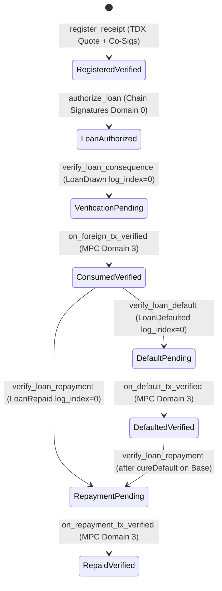
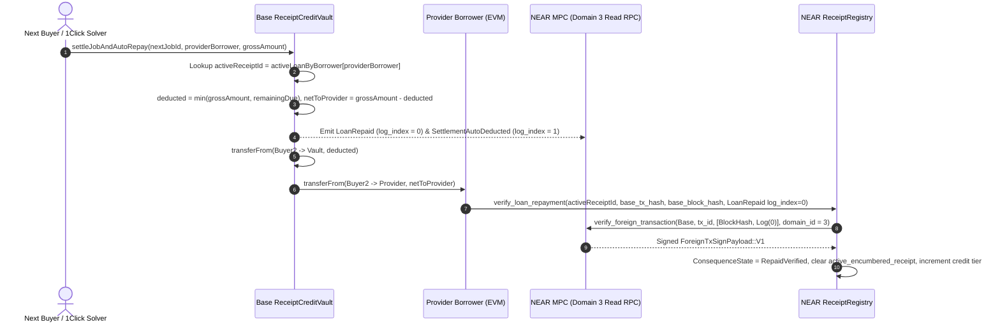

# Repayment, Auto-Deduction, Default Handling, Dynamic Credit Limits & First-Loss Pool Design (`docs/REPAYMENT-DEFAULT.md`)

> **Branch:** `repayment-default-design` (branched from `hardening-post-submission` at `1a9f8d8f1f64e4c4b65fc5fdc23964482f2fbbd9`)  
> **Baseline:** [`contracts/base-sepolia/ReceiptCreditVault.sol`](../contracts/base-sepolia/ReceiptCreditVault.sol), [`crates/near-receipt-registry/src/lib.rs`](../crates/near-receipt-registry/src/lib.rs), [`crates/receipt-core/src/receipt.rs`](../crates/receipt-core/src/receipt.rs), [`crates/receipt-core/src/eip712.rs`](../crates/receipt-core/src/eip712.rs), [`crates/receipt-core/src/mpc_foreign_tx.rs`](../crates/receipt-core/src/mpc_foreign_tx.rs), and [`crates/receipt-core/src/confidential.rs`](../crates/receipt-core/src/confidential.rs).  
> **Scope:** Architectural & contract specification only (no contract changes implemented in this commit).

> **Status:** Design only, not implemented. All parameters (tiers, caps, 15% first-loss coverage, 40/60 yield split) are illustrative.
---

## 1. Executive Summary & Lifecycle Extension

In the hardened baseline (`hardening-post-submission`), a verified work receipt (`ReceiptV1`) transitions through:

$$\text{RegisteredVerified} \xrightarrow{\text{authorize\_loan (Domain 0)}} \text{LoanAuthorized} \xrightarrow{\text{verify\_loan\_consequence (Domain 3)}} \text{ConsumedVerified}$$

However, [`ReceiptCreditVault.sol`](../contracts/base-sepolia/ReceiptCreditVault.sol) currently stops at disbursement (`drawCredit`), and [`ReceiptRegistry`](../crates/near-receipt-registry/src/lib.rs) treats `ConsumedVerified` as a terminal state. This specification closes the full credit lifecycle across Base Sepolia and NEAR:



---

## 2. How Repayment Is Recorded on the Base Vault (`ReceiptCreditVault.sol`)

### 2.1 On-Chain Loan Accounting State
Currently, [`ReceiptCreditVault.sol`](../contracts/base-sepolia/ReceiptCreditVault.sol#L39) only stores `mapping(bytes32 => bool) public consumedReceipts`. We retain `consumedReceipts` for backward compatibility and add per-loan position tracking:

```solidity
enum LoanState {
    None,       // 0: Never drawn
    Active,     // 1: Drawn via drawCredit; principal/interest outstanding
    Repaid,     // 2: Principal + interest fully repaid
    Defaulted   // 3: Past maturityAt + gracePeriodSecs; first-loss waterfall executed
}

struct LoanPosition {
    bytes32 receiptId;
    address borrower;
    uint128 principal;
    uint128 interestAmount;
    uint128 repaidAmount;
    uint128 holdbackBonded;
    uint64 drawnAt;
    uint64 maturityAt;
    bytes32 evidenceCommitment;
    LoanState state;
}

mapping(bytes32 => LoanPosition) public loans;
mapping(address => bytes32) public activeLoanByBorrower;
```

### 2.2 Extended EIP-712 `LoanAuthorization` Parameters
To bind loan maturity and fixed financing fee into the NEAR Chain Signatures (`domain_id: 0`) authorization, `LOAN_AUTH_TYPEHASH` is extended (or versioned under EIP-712 domain version `"2"`):

```solidity
bytes32 public constant LOAN_AUTH_TYPEHASH = keccak256(
    "LoanAuthorization(bytes32 receiptId,address borrower,uint256 principal,uint256 interestAmount,uint64 maturityAt,bytes32 evidenceCommitment,uint256 deadline)"
);
```

When `drawCredit(...)` executes:
1. Validates `block.timestamp <= deadline`, `maturityAt > block.timestamp`, and `activeLoanByBorrower[borrower] == bytes32(0)` (at most one active working-capital loan per borrower address at a time).
2. Retains `holdback = (principal * providerHoldbackBps) / 10_000` inside `providerFirstLossBond[borrower]` and disburses `principal - holdback` (or full `principal` when `providerHoldbackBps == 0`) in `creditToken`.
3. Records `loans[receiptId] = LoanPosition({ ..., state: LoanState.Active })` and `activeLoanByBorrower[borrower] = receiptId`.
4. Emits `LoanDrawn` at **`log_index: 0`** before calling `creditToken.transfer(...)`.

### 2.3 Direct & Partial/Full Repayment (`repayLoan`)
[`IERC20Minimal`](../contracts/base-sepolia/ReceiptCreditVault.sol#L4-L7) is extended with `transferFrom(address from, address to, uint256 amount) external returns (bool)`.

`repayLoan(bytes32 receiptId, uint256 amount)`:
1. Loads `LoanPosition storage loan = loans[receiptId]`; reverts with `LoanNotActive(receiptId)` unless `loan.state == LoanState.Active`.
2. Computes:
   $$\text{totalDue} = \text{uint256}(\text{loan.principal}) + \text{uint256}(\text{loan.interestAmount})$$
   $$\text{remainingDue} = \text{totalDue} - \text{uint256}(\text{loan.repaidAmount})$$
   $$\text{applied} = \min(\text{amount},\; \text{remainingDue})$$
3. Splits `applied` into principal reduction and interest revenue (principal recovered first so LP principal coverage is restored earliest, then interest):
   - `uint256 unpaidPrincipalBefore = loan.principal > loan.repaidAmount ? loan.principal - loan.repaidAmount : 0;`
   - `uint256 principalPortion = applied <= unpaidPrincipalBefore ? applied : unpaidPrincipalBefore;`
   - `uint256 interestPortion = applied - principalPortion;`
4. Updates state **before** external ERC-20 calls (CEI):
   - `loan.repaidAmount += uint128(applied);`
   - Credits `interestPortion` across the First-Loss Junior Pool (`juniorFirstLossReserve`) and Senior LP Pool (`seniorLiquidityAssets`) according to `juniorYieldShareBps`.
   - If `loan.repaidAmount == totalDue`:
     - Sets `loan.state = LoanState.Repaid`.
     - Clears `activeLoanByBorrower[loan.borrower] = bytes32(0)`.
     - Releases `loan.holdbackBonded` from `providerFirstLossBond[loan.borrower]`.
5. **Deterministic `log_index: 0` Emission for NEAR MPC Read RPC:**
   - Emits `LoanRepaid` **before** calling `creditToken.transferFrom(msg.sender, address(this), applied)` so `LoanRepaid` is guaranteed to appear at `log_index: 0` in the Base transaction receipt (before the ERC-20 `Transfer` event at `log_index: 1`):
   ```solidity
   event LoanRepaid(
       bytes32 indexed receiptId,
       address indexed borrower,
       uint256 amountPaid,
       uint256 remainingBalance,
       bytes32 indexed lenderId,
       bytes32 evidenceCommitment
   );
   ```
6. Invokes `creditToken.transferFrom(msg.sender, address(this), applied)` and reverts with `CreditTransferFailed()` if false.

---

## 3. How Repayment Is Auto-Deducted from the Provider's Next Settlement

Working-capital advances should self-liquidate out of the provider's next completed job without requiring manual borrower transactions. We design a two-layer auto-deduction architecture that works for both **direct Base EVM settlements** and **NEAR Confidential Intents (`1Click`) cross-chain settlements**.



### 3.1 Base Settlement Router Entrypoint (`ReceiptCreditVault::settleJobAndAutoRepay`)
When any buyer agent (or 1Click EVM destination solver) settles an invoice of `grossSettlementAmount` for `providerBorrower` on Base:

```solidity
function settleJobAndAutoRepay(
    bytes32 nextJobId,
    address providerBorrower,
    uint256 grossSettlementAmount
) external returns (uint256 deductedForLoan, uint256 netPaidToProvider);
```

Execution flow:
1. Looks up `bytes32 activeReceiptId = activeLoanByBorrower[providerBorrower]`.
2. **If `activeReceiptId != bytes32(0)` and `loans[activeReceiptId].state == LoanState.Active`:**
   - Computes `remainingDue = (uint256(loan.principal) + uint256(loan.interestAmount)) - uint256(loan.repaidAmount)`.
   - Sets `deductedForLoan = grossSettlementAmount <= remainingDue ? grossSettlementAmount : remainingDue`.
   - Sets `netPaidToProvider = grossSettlementAmount - deductedForLoan`.
   - Applies `deductedForLoan` to `loan.repaidAmount` (if `loan.repaidAmount == totalDue`, transitions `loan.state = LoanState.Repaid` and clears `activeLoanByBorrower[providerBorrower] = bytes32(0)`).
   - **Emits `LoanRepaid(...)` at `log_index: 0`** and `SettlementAutoDeducted(nextJobId, activeReceiptId, providerBorrower, grossSettlementAmount, deductedForLoan, netPaidToProvider)` at `log_index: 1`.
   - Pulls `creditToken.transferFrom(msg.sender, address(this), deductedForLoan)` into the vault and `creditToken.transferFrom(msg.sender, providerBorrower, netPaidToProvider)` to the provider.
3. **If no active loan exists:**
   - Emits `SettlementAutoDeducted(nextJobId, bytes32(0), providerBorrower, grossSettlementAmount, 0, grossSettlementAmount)` at `log_index: 0` and transfers `grossSettlementAmount` directly to `providerBorrower`.

### 3.2 NEAR Confidential Intents & Registry-Enforced Encumbrance (`OneClickIntentBuilder`)
To prevent a provider from bypassing `settleJobAndAutoRepay` when settling off-EVM via NEAR Confidential Intents:
1. **Registry Encumbrance Tracking (`ReceiptRegistry`):**
   - Adds `pub active_encumbered_receipt: BTreeMap<String, [u8; 32]>` (`provider_identity -> receipt_id`) and `pub active_encumbered_borrower: BTreeMap<[u8; 20], [u8; 32]>` (`borrower_evm_address -> receipt_id`).
   - Populated when `on_foreign_tx_verified` marks a receipt `ConsumedVerified`.
   - Cleared only when `on_repayment_tx_verified` confirms a `LoanRepaid` event with `remainingBalance == 0`.
2. **Split-Payout Confidential Settlement Commitment (`crates/receipt-core/src/confidential.rs`):**
   - Extends [`OneClickIntentBuilder`](../crates/receipt-core/src/confidential.rs#L160) with `build_encumbered_quote_request(...)`, which routes the encumbered deduction leg (`min(settlement_amount, outstanding_debt)`) directly to `ReceiptCreditVault` on `eip155:84532` and binds `encumbrance_receipt_id: Option<[u8; 32]>` into the confidential settlement commitment (`RECEIPT_CONFIDENTIAL_V2`).
3. **No New Loan Draw Without Repayment:**
   - `ReceiptRegistry::authorize_loan_internal` checks `!self.active_encumbered_receipt.contains_key(&receipt.provider_identity)` and `!self.active_encumbered_borrower.contains_key(&borrower)` before signing a new `LoanAuthorization`. A provider can still register new `RegisteredVerified` work receipts while a loan is active, but cannot draw a second loan until the active loan reaches `RepaidVerified`.

---

## 4. How Default Is Detected and Handled

### 4.1 Permissionless Default Trigger on Base (`ReceiptCreditVault::markDefaulted`)
Every active loan carries an immutable `maturityAt` timestamp signed inside the EIP-712 `LoanAuthorization` plus a vault-level `uint64 public immutable gracePeriodSecs` (e.g., `86_400` seconds = 24 hours on mainnet; configurable down to `60` seconds for testnet testing).

```solidity
event LoanDefaulted(
    bytes32 indexed receiptId,
    address indexed borrower,
    uint256 unpaidPrincipal,
    uint256 firstLossAbsorbed,
    bytes32 indexed lenderId,
    bytes32 evidenceCommitment
);

function markDefaulted(bytes32 receiptId) external;
```

Execution flow inside `markDefaulted(bytes32 receiptId)`:
1. Verifies `loan.state == LoanState.Active`.
2. Verifies `block.timestamp > uint256(loan.maturityAt) + uint256(gracePeriodSecs)`; otherwise reverts with `LoanNotExpired(receiptId, loan.maturityAt + gracePeriodSecs, block.timestamp)`.
3. Computes `unpaidPrincipal = loan.principal > loan.repaidAmount ? uint256(loan.principal - loan.repaidAmount) : 0`.
4. Transitions `loan.state = LoanState.Defaulted` and sets `defaultedBorrower[loan.borrower] = true` (blocking any future `drawCredit` for `loan.borrower` on the vault).
5. Executes the **First-Loss Absorption Waterfall** (Section 6) to cover `unpaidPrincipal` from:
   - Step A: `providerFirstLossBond[loan.borrower]`
   - Step B: `juniorFirstLossReserve`
   - Step C: `seniorLiquidityAssets` (only if `unpaidPrincipal` exceeds Step A + Step B)
6. **Emits `LoanDefaulted` at `log_index: 0`** so NEAR MPC `verify_foreign_transaction` (`EvmExtractor::Log { log_index: 0 }`) can deterministically extract and sign the default event.

### 4.2 Cross-Chain Default Verification on NEAR (`ReceiptRegistry::verify_loan_default`)
Anyone (keeper, lender, or buyer) can submit the Base `markDefaulted` transaction hash, block hash, and `LoanDefaulted` log (`log_index: 0`) to `ReceiptRegistry::verify_loan_default`:
1. `verify_loan_default_internal` validates `receipt.consequence_state == ConsequenceState::ConsumedVerified`.
2. Calls `receipt_core::eip712::verify_loan_defaulted_log(...)` to verify:
   - `!log.removed`
   - `log.address == loan_auth.base_vault_address`
   - `log.topics[0] == keccak256("LoanDefaulted(bytes32,address,uint256,uint256,bytes32,bytes32)")`
   - `log.topics[1] == receipt_id`
   - `log.topics[2] == abi_pad(loan_auth.borrower_evm_address)`
   - `log.topics[3] == lender_id`
   - `log.data[64..96] == receipt.evidence_commitment`
3. Builds `ForeignTxSignPayload::V1` (`[EvmExtractor::BlockHash, EvmExtractor::Log { log_index: 0 }]`), sets `receipt.consequence_state = ConsequenceState::DefaultVerificationPending`, and invokes `v1.signer-prod.testnet::verify_foreign_transaction` (`domain_id: 3`).
4. In `on_default_tx_verified_internal`:
   - Verifies the MPC Domain 3 secp256k1 signature against `self.foreign_tx_domain_root_pubkey`.
   - Sets `receipt.consequence_state = ConsequenceState::DefaultedVerified`.
   - Updates `self.provider_profiles.entry(provider_identity)`: increments `defaults_count += 1`, sets `credit_frozen = true`, resets `reputation_streak = 0`, and updates the corresponding `ConsequenceNode` in `provider_credit_graph` with `terminal_state = ConsequenceState::DefaultedVerified` and `default_finality_evidence`.

### 4.3 Late Cure (`ReceiptCreditVault::cureDefault`)
If a defaulted provider later repays the full unpaid balance plus late penalty via `cureDefault(bytes32 receiptId)` on Base:
- `cureDefault` replenishes `seniorLiquidityAssets` first, then `juniorFirstLossReserve` (the slashed `providerFirstLossBond` is not refunded), clears `defaultedBorrower[loan.borrower] = false`, sets `loan.state = LoanState.Repaid`, and emits `LoanRepaid` at `log_index: 0` with `remainingBalance = 0`.
- Submitting that `LoanRepaid` log to `ReceiptRegistry::verify_loan_repayment` transitions the receipt to `RepaidVerified` and unfreezes `credit_frozen = false`, though `historical_defaults_count` remains permanent in `ProviderCreditProfile` (capping the provider at Tier 0/1 until a clean streak is rebuilt).

---

## 5. How Credit Limits Scale with Verified Receipt History

### 5.1 Provider Credit Profile & Sybil-Resistant Counterparty Diversity
In [`crates/near-receipt-registry/src/lib.rs`](../crates/near-receipt-registry/src/lib.rs#L441), `provider_credit_graph` currently stores `Vec<ConsequenceNode>`. To prevent two colluding accounts (Buyer $A$ and Provider $P$) from wash-trading micro-jobs to unlock a large loan (the #1 open item in `Known Gaps`), we add `buyer_pubkey: [u8; 32]` to `ConsequenceNode` and maintain `ProviderCreditProfile`:

```rust
#[derive(BorshSerialize, BorshDeserialize, Serialize, Deserialize, Clone, Debug, PartialEq, Eq)]
pub struct ProviderCreditProfile {
    pub provider_identity: String,
    pub total_registered_receipts: u32,
    pub total_loans_drawn: u32,
    pub total_loans_repaid: u32,
    pub active_defaults_count: u32,
    pub historical_defaults_count: u32,
    pub cumulative_repaid_principal: u128,
    pub distinct_repaid_buyers: BTreeSet<[u8; 32]>,
    pub per_buyer_repaid_count: BTreeMap<[u8; 32], u32>,
    pub credit_frozen: bool,
}
```

### 5.2 Deterministic Credit Limit Formula (`compute_provider_credit_limit`)
Let:
- `MAX_RECEIPTS_PER_BUYER_FOR_TIER: u32 = 2` (at most 2 repaid loans from the same `buyer_pubkey` count toward effective repaid count $N_{\text{eff}}$).
- $N_{\text{eff}} = \sum_{b \in \text{distinct\_repaid\_buyers}} \min(\text{per\_buyer\_repaid\_count}[b],\; 2)$.
- $B_{\text{distinct}} = |\text{distinct\_repaid\_buyers}|$.
- $V_{\text{repaid}} = \text{cumulative\_repaid\_principal}$ (in 6-decimal `mUSDC`, where `1_000_000 = 1 mUSDC`).

**Hard Freeze Rules:**
- If `profile.credit_frozen` or `profile.active_defaults_count > 0` or `self.active_encumbered_receipt.contains_key(provider_identity)`:
  $$\text{AvailableCreditLimit}(P) = 0$$

**Tier Progression Table (when unencumbered and unfrozen):**

| Tier | Qualification Criteria | Base Tier Cap (`max_principal`) | Max Advance LTV vs. Receipt Cap | Max Maturity (`maturityDurationSecs`) | Historical Default Penalty |
| :--- | :--- | :--- | :--- | :--- | :--- |
| **Tier 0 (Seed)** | $N_{\text{eff}} \ge 0$ (First verified `PASS` receipt) | `250 mUSDC` (`250_000_000`) | `100%` of `receipt.max_credit_principal` up to `250 mUSDC` | `7 days` (`604,800s`) | Default tier if `historical_defaults_count > 0` and $N_{\text{eff}} < 5$ |
| **Tier 1 (Established)** | $N_{\text{eff}} \ge 2$ and $B_{\text{distinct}} \ge 2$ | `1,000 mUSDC` (`1_000_000_000`) | `100%` of `receipt.max_credit_principal` up to `1,000 mUSDC` | `14 days` (`1,209,600s`) | Capped at Tier 1 if `historical_defaults_count == 1` |
| **Tier 2 (Proven)** | $N_{\text{eff}} \ge 5$, $B_{\text{distinct}} \ge 3$, $V_{\text{repaid}} \ge 2,500\text{ mUSDC}$ | `5,000 mUSDC` (`5_000_000_000`) | `100%` of `receipt.max_credit_principal` up to `5,000 mUSDC` | `30 days` (`2,592,000s`) | Requires `historical_defaults_count == 0` |
| **Tier 3 (Institutional)** | $N_{\text{eff}} \ge 15$, $B_{\text{distinct}} \ge 5$, $V_{\text{repaid}} \ge 20,000\text{ mUSDC}$ | $\min\left(25,000\text{ mUSDC},\; 5,000\text{ mUSDC} + \lfloor 0.25 \times V_{\text{repaid}} \rfloor\right)$ | `100%` of `receipt.max_credit_principal` up to Tier 3 cap | `60 days` (`5,184,000s`) | Requires `historical_defaults_count == 0` |

Inside `ReceiptRegistry::authorize_loan_internal`:
```rust
let provider_limit = self.compute_provider_credit_limit(&receipt.provider_identity);
let effective_cap = receipt.max_credit_principal.min(provider_limit);
if principal > effective_cap {
    rt::panic_str("principal_amount exceeds effective history-scaled credit limit");
}
```

---

## 6. Proposed First-Loss Pool Architecture (`ReceiptCreditVault.sol`)

To make `ReceiptCreditVault` investable for institutional and DeFi liquidity providers, senior LP capital must be insulated from early agent defaults by a dedicated first-loss buffer.

### 6.1 Three-Tranche Reserve Accounting on `ReceiptCreditVault`
We partition vault reserves into three explicit buckets inside [`ReceiptCreditVault.sol`](../contracts/base-sepolia/ReceiptCreditVault.sol):

1. **Tranche 1 — Provider Holdback Bond (`mapping(address => uint256) public providerFirstLossBond`)**
   - On every `drawCredit`, `providerHoldbackBps` (default `500 bps = 5%`) of `principal` is retained inside the vault in `providerFirstLossBond[borrower]`.
   - When the borrower repays in full (`loan.state == LoanState.Repaid`), the holdback bond is credited toward the final `5%` of principal repayment (or returned to `borrower`).
   - If the borrower defaults, `100%` of `providerFirstLossBond[borrower]` is slashed first.
2. **Tranche 2 — Junior First-Loss Pool (`uint256 public juniorFirstLossReserve`, `mapping(address => uint256) public juniorLpShares`)**
   - Seeded by protocol/foundation grant capital or risk-seeking underwriters via `depositJuniorFirstLoss(uint256 amount)`.
   - Absorbs `100%` of default losses remaining after `providerFirstLossBond[borrower]` is exhausted.
   - Earns an enhanced yield share: `juniorYieldShareBps` (default `4000 bps = 40%`) of all `interestPortion` collected on `repayLoan` and `settleJobAndAutoRepay`, even though the Junior Pool only needs to represent `15%–20%` of total vault TVL (yielding $2\times–2.6\times$ capital-adjusted APR vs. Senior LPs).
3. **Tranche 3 — Senior Liquidity Pool (`uint256 public seniorLiquidityReserve`, `mapping(address => uint256) public seniorLpShares`)**
   - Deposited via `depositSeniorLiquidity(uint256 amount)`.
   - Earns `10_000 - juniorYieldShareBps` (`60%`) of all interest collected.
   - Protected by a **Minimum First-Loss Coverage Gate** enforced inside `drawCredit`:
     $$\text{juniorFirstLossReserve} \times 10000 \ge (\text{totalActivePrincipal} + \text{principal}) \times \text{minFirstLossCoverageBps}$$
     With `minFirstLossCoverageBps = 1500` (`15%`), `drawCredit` reverts with `InsufficientFirstLossCoverage()` if a new loan would dilute the Junior First-Loss Pool below `15%` of total outstanding active principal.

### 6.2 Loss-Absorption Waterfall on `markDefaulted(bytes32 receiptId)`
When `markDefaulted(receiptId)` triggers with `uint256 loss = unpaidPrincipal`:

```solidity
uint256 bondSlashed = loss <= providerFirstLossBond[loan.borrower]
    ? loss
    : providerFirstLossBond[loan.borrower];
providerFirstLossBond[loan.borrower] -= bondSlashed;
uint256 remainingLoss = loss - bondSlashed;

uint256 juniorSlashed = remainingLoss <= juniorFirstLossReserve
    ? remainingLoss
    : juniorFirstLossReserve;
juniorFirstLossReserve -= juniorSlashed;
remainingLoss -= juniorSlashed;

if (remainingLoss > 0) {
    seniorLiquidityReserve = seniorLiquidityReserve > remainingLoss
        ? seniorLiquidityReserve - remainingLoss
        : 0;
}
totalActivePrincipal -= unpaidPrincipal;
```

---

## 7. Exact Contract & Registry Functions to Change or Add

### 7.1 Base Sepolia Solidity Contract (`contracts/base-sepolia/ReceiptCreditVault.sol`)

| Symbol | Action | Signature & Responsibility |
| :--- | :--- | :--- |
| `IERC20Minimal::transferFrom` | **Add to interface** | `function transferFrom(address from, address to, uint256 amount) external returns (bool);` |
| `LOAN_AUTH_TYPEHASH` | **Modify** | Include `uint256 interestAmount,uint64 maturityAt` in EIP-712 `LoanAuthorization` struct typehash. |
| `LoanState` / `LoanPosition` | **Add struct/enum** | Track `principal`, `interestAmount`, `repaidAmount`, `holdbackBonded`, `drawnAt`, `maturityAt`, `evidenceCommitment`, and `LoanState`. |
| `loans`, `activeLoanByBorrower`, `defaultedBorrower` | **Add storage maps** | Map `receiptId -> LoanPosition`, `borrower -> activeReceiptId`, and `borrower -> isDefaulted`. |
| `providerFirstLossBond`, `juniorFirstLossReserve`, `seniorLiquidityReserve`, `totalActivePrincipal` | **Add storage** | First-loss bond & two-tranche liquidity pool accounting variables. |
| `LoanRepaid`, `LoanDefaulted`, `SettlementAutoDeducted`, `FirstLossDeposited` | **Add events** | `LoanRepaid` and `LoanDefaulted` emitted strictly at `log_index: 0` before any ERC-20 `transfer`/`transferFrom`. |
| `computeStructHash` & `computeLoanDigest` | **Modify** | Accept `(receiptId, borrower, principal, interestAmount, maturityAt, evidenceCommitment, deadline)`. |
| `drawCredit` | **Modify** | Validate `!defaultedBorrower[borrower]`, `activeLoanByBorrower[borrower] == bytes32(0)`, and `juniorFirstLossReserve` coverage gate; deduct `holdbackBonded`; initialize `loans[receiptId]`; emit `LoanDrawn` at `log_index: 0`. |
| `repayLoan` | **Add function** | `function repayLoan(bytes32 receiptId, uint256 amount) external;` — record partial/full repayment, split principal/interest, emit `LoanRepaid` at `log_index: 0`, pull `transferFrom`. |
| `settleJobAndAutoRepay` | **Add function** | `function settleJobAndAutoRepay(bytes32 nextJobId, address providerBorrower, uint256 grossSettlementAmount) external returns (uint256 deducted, uint256 netPaid);` — auto-deduct active loan balance from incoming job settlement, emit `LoanRepaid` at `log_index: 0`. |
| `markDefaulted` | **Add function** | `function markDefaulted(bytes32 receiptId) external;` — check `block.timestamp > maturityAt + gracePeriodSecs`, run 3-tier first-loss waterfall, emit `LoanDefaulted` at `log_index: 0`. |
| `cureDefault` | **Add function** | `function cureDefault(bytes32 receiptId) external;` — pull full unpaid balance, restore senior/junior reserves, emit `LoanRepaid` at `log_index: 0`. |
| `depositJuniorFirstLoss` / `depositSeniorLiquidity` | **Add functions** | Tranche funding entrypoints for junior first-loss backstop and senior LPs. |

### 7.2 Shared Rust Core Crate (`crates/receipt-core/`)

| File & Symbol | Action | Signature & Responsibility |
| :--- | :--- | :--- |
| `src/receipt.rs::ConsequenceState` | **Modify enum** | Add `RepaymentVerificationPending`, `RepaidVerified`, `DefaultVerificationPending`, `DefaultedVerified`. |
| `src/eip712.rs::LOAN_AUTHORIZATION_TYPE_STR` & `LoanAuthorizationPacket` | **Modify** | Add `interest_amount: u128` and `maturity_at: u64` to `LoanAuthorizationPacket` and `eip712_loan_authorization_digest`. |
| `src/eip712.rs::verify_loan_repaid_log` | **Add function** | Validate `LoanRepaid` `EvmLog` (`topics[0..4]`, `amountPaid`, `remainingBalance`, `evidenceCommitment`). |
| `src/eip712.rs::verify_loan_defaulted_log` | **Add function** | Validate `LoanDefaulted` `EvmLog` (`topics[0..4]`, `unpaidPrincipal`, `firstLossAbsorbed`, `evidenceCommitment`). |
| `src/mpc_foreign_tx.rs::loan_repaid_topic0` & `loan_defaulted_topic0` | **Add functions** | Return `keccak256("LoanRepaid(...)")` and `keccak256("LoanDefaulted(...)")` topic0 constants. |
| `src/confidential.rs::OneClickIntentBuilder` | **Add method** | `build_encumbered_quote_request(...)` for split-payout settlement auto-deduction when a provider has an active loan. |

### 7.3 NEAR Receipt Registry Contract (`crates/near-receipt-registry/src/lib.rs`)

| Symbol | Action | Signature & Responsibility |
| :--- | :--- | :--- |
| `ProviderCreditProfile` | **Add struct** | Track `total_loans_drawn`, `total_loans_repaid`, `active_defaults_count`, `historical_defaults_count`, `cumulative_repaid_principal`, `distinct_repaid_buyers`, `per_buyer_repaid_count`, `credit_frozen`. |
| `ReceiptRegistry` state fields | **Modify struct** | Add `active_encumbered_receipt: BTreeMap<String, [u8; 32]>`, `active_encumbered_borrower: BTreeMap<[u8; 20], [u8; 32]>`, `provider_profiles: BTreeMap<String, ProviderCreditProfile>`. |
| `ConsequenceNode` | **Modify struct** | Add `buyer_pubkey: [u8; 32]`, `interest_amount: u128`, `maturity_at: u64`, `repaid_amount: u128`, `terminal_state: ConsequenceState`, and `terminal_finality_evidence: Option<VerifiedFinalityEvidence>`. |
| `compute_provider_credit_limit` | **Add view method** | `pub fn compute_provider_credit_limit(&self, provider_identity: String) -> U128` — compute Tier 0–3 credit cap from verified repayment history and sybil-damped distinct buyer count. |
| `get_provider_credit_profile` | **Add view method** | `pub fn get_provider_credit_profile(&self, provider_identity: String) -> Option<ProviderCreditProfile>`. |
| `authorize_loan` / `authorize_loan_internal` | **Modify** | Accept `interest_amount: U128, maturity_at: u64`; reject if provider/borrower has an active encumbered loan or `credit_frozen`; enforce `principal <= min(receipt.max_credit_principal, compute_provider_credit_limit)`. |
| `on_foreign_tx_verified_internal` | **Modify** | Record `(provider_identity -> receipt_id)` in `active_encumbered_receipt` and `(borrower -> receipt_id)` in `active_encumbered_borrower` when transitioning to `ConsumedVerified`. |
| `verify_loan_repayment` & `on_repayment_tx_verified` | **Add methods** | Verify Base `LoanRepaid` (`log_index: 0`) via `v1.signer-prod.testnet::verify_foreign_transaction` (`domain_id: 3`); on `remainingBalance == 0`, transition to `RepaidVerified`, clear encumbrance maps, and increment `ProviderCreditProfile` tier metrics. |
| `verify_loan_default` & `on_default_tx_verified` | **Add methods** | Verify Base `LoanDefaulted` (`log_index: 0`) via `v1.signer-prod.testnet::verify_foreign_transaction` (`domain_id: 3`); transition to `DefaultedVerified`, increment `defaults_count`, and set `credit_frozen = true`. |

---

## 8. File-by-File Change List & Testnet Implementation Time Estimate

### 8.1 File-by-File Change List

| File | Planned Changes |
| :--- | :--- |
| `contracts/base-sepolia/ReceiptCreditVault.sol` | Add `LoanState`, `LoanPosition`, `loans`, `activeLoanByBorrower`, `defaultedBorrower`, 3-tier first-loss pool storage (`providerFirstLossBond`, `juniorFirstLossReserve`, `seniorLiquidityReserve`), `repayLoan`, `settleJobAndAutoRepay`, `markDefaulted`, `cureDefault`, `depositJuniorFirstLoss`, `depositSeniorLiquidity`, and updated `LOAN_AUTH_TYPEHASH`. |
| `contracts/base-sepolia/artifacts/*` | Recompile `ReceiptCreditVault.abi` and `ReceiptCreditVault.bin` via `solc 0.8.24 --optimize`. |
| `crates/receipt-core/src/receipt.rs` | Extend `ConsequenceState` enum with `RepaymentVerificationPending`, `RepaidVerified`, `DefaultVerificationPending`, `DefaultedVerified`. |
| `crates/receipt-core/src/eip712.rs` | Update `LOAN_AUTHORIZATION_TYPE_STR`, `LoanAuthorizationPacket`, and `eip712_loan_authorization_digest` for `interest_amount` + `maturity_at`; implement `verify_loan_repaid_log` and `verify_loan_defaulted_log` + unit tests. |
| `crates/receipt-core/src/mpc_foreign_tx.rs` | Add `loan_repaid_topic0()` and `loan_defaulted_topic0()` helpers and golden Borsh payload tests for repayment and default logs. |
| `crates/receipt-core/src/confidential.rs` | Add `OneClickIntentBuilder::build_encumbered_quote_request` supporting auto-deduction split routing to Base `ReceiptCreditVault`. |
| `crates/near-receipt-registry/src/lib.rs` | Add `ProviderCreditProfile`, encumbrance maps, `compute_provider_credit_limit`, `verify_loan_repayment` + callback, `verify_loan_default` + callback, and negative unit tests (encumbered second-draw rejection, default freeze rejection, sybil wash-pair tier-cap enforcement, Tier 0→1→2 upgrade after distinct-buyer repayments). |
| `crates/near-receipt-registry/tests/evm_cross_chain_integration.rs` | Extend the `revm` cross-stack test to cover: (1) auto-deduction via `settleJobAndAutoRepay` → `verify_loan_repayment` → `RepaidVerified` → Tier 1 credit limit expansion, and (2) maturity expiry → `markDefaulted` first-loss waterfall → `verify_loan_default` → `DefaultedVerified` credit freeze. |
| `src/receipt_orchestrator/demo_e2e.py` | Add Steps 8–10 to the live testnet orchestrator: seed `depositJuniorFirstLoss`, execute `settleJobAndAutoRepay` on Base Sepolia, and call `verify_loan_repayment` on NEAR Testnet. |

### 8.2 Testnet Implementation Time Estimate

| Phase | Tasks | Estimated Effort |
| :--- | :--- | :--- |
| **1. Solidity Vault & First-Loss Pool (`ReceiptCreditVault.sol`)** | Implement `LoanPosition`, `repayLoan`, `settleJobAndAutoRepay`, `markDefaulted`, `cureDefault`, 3-tranche first-loss waterfall, and recompile `solc 0.8.24` artifacts. | **3–4 hours** |
| **2. Rust Core Primitives (`crates/receipt-core`)** | Update `ConsequenceState`, EIP-712 `LoanAuthorizationPacket` (`interest_amount`, `maturity_at`), `verify_loan_repaid_log`, `verify_loan_defaulted_log`, and unit tests. | **2–3 hours** |
| **3. NEAR Registry Underwriting & Callbacks (`crates/near-receipt-registry`)** | Implement `ProviderCreditProfile`, sybil-damped `compute_provider_credit_limit`, encumbrance guards, `verify_loan_repayment`, `verify_loan_default`, and negative tests. | **4–5 hours** |
| **4. Cross-Stack `revm` & Live Testnet E2E (`demo_e2e.py`)** | Extend `evm_cross_chain_integration.rs` for repayment/default loops, deploy updated contracts to NEAR Testnet & Base Sepolia, and record live tx hashes. | **3–4 hours** |
| **Total End-to-End Testnet Implementation** | Full implementation, negative regression suite, `revm` integration tests, and live NEAR Testnet + Base Sepolia execution | **~12–16 engineering hours (1.5–2 days)** |
